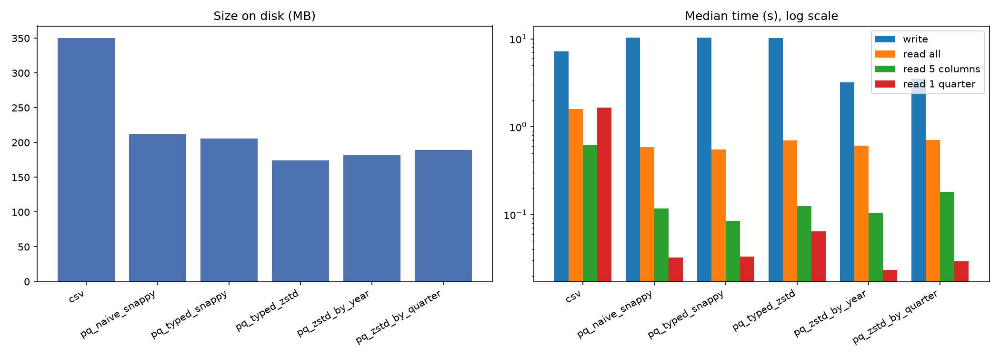
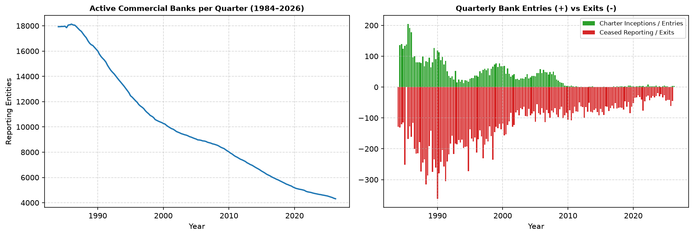

# NATIONAL ECONOMICS UNIVERSITY
## BFT65B – BIG DATA ANALYTICS IN FINANCE
### FINAL INDIVIDUAL RESEARCH REPORT: A BIG-DATA PIPELINE FOR BANK FAILURE EARLY WARNING

---

* **Author**: Hứa Văn Phúc
* **Student ID (MSSV)**: 11231006
* **Cohort / Class**: BFT65B – Big Data Analytics in Finance
* **GitHub Repository URL**: https://github.com/hvphuc05/FDIC_Bank_Failure_EWS
* **Data Ingestion Date**: 2026-11-08 / 2026-11-09
* **Acquisition Methodology**: FDIC Public BankFind API (Automated, Resumable Python Pipeline with SHA-256 Checksums)
* **Dataset Scope**: 1984Q1 to 2026Q2 (170 Quarters)
* **Verified Row Counts**:
  * Financial Call Reports (`financials`): 1,682,616 rows across 24,064 distinct bank charters
  * Bank Structure & Event Directory (`institutions`): 27,835 records
  * Failure Registry (`failures`): 4,117 records
* **Modelling Scope**: bank-quarters 1984Q1 – 2025Q2 carry a complete 4-quarter label; 2025Q3 – 2026Q2 (17,529 rows) stay in the panel with a null label (`split = unlabeled`)
* **Development Period**: REPDTE 1984Q1 – 2006Q4 — 1,193,818 bank-quarters, 8,688 positive rows, **2,290 failed banks** (2,299 `FAILURE` records with failure date in 1984-04-01 .. 2007-12-31)
* **Purged Gap**: 2007Q1 – 2007Q4 (34,754 rows, 48 positive rows), excluded from development and from test
* **Test Period (out-of-time)**: REPDTE 2008Q1 – 2025Q2 — 435,446 bank-quarters, 2,134 positive rows, **545 failed banks** (545 `FAILURE` records with failure date in 2008-04-01 .. 2026-06-30). Evaluated once, after the design is frozen (§6.7)

---

# 1. Executive Summary & Context

*(To be finalized in Part 6: answers to Q1, Q2, Q3 from the perspective of the State Bank of Vietnam. Status of this draft: Parts 1, 2, 4 and the design of Part 5 are complete; Part 3 and the test evaluation are pending.)*

---

# 2. Part 1: Data Acquisition & Storage Layout Design

## 2.1 Reproducible Acquisition Architecture & Verification

In bank failure early-warning systems, regulatory integrity demands that the ingestion pipeline is fully reproducible, deterministic, and verifiable. Using the public FDIC BankFind Suite API, an automated, resumable extraction pipeline was implemented (`src/01_download.py`) covering the complete temporal scope specified by the supervisory authority: **1984Q1 to 2026Q2 (170 consecutive quarters)**.

To prevent transient network failures or abrupt process interruptions from corrupting the local repository, the acquisition engine implements three core engineering safeguards:
1. **Resumable Manifest Auditing**: An atomic cryptographic ledger (`manifest.json`) records the status, row count, API-reported `meta.total`, and SHA-256 hash digest of each quarterly batch. Any previously downloaded quarter that matches its cryptographic signature is skipped upon re-execution.
2. **Atomic Ingestion Commits**: Data payloads are staged to a temporary file (`.parquet.tmp`) and only committed to the persistent directory via an atomic filesystem rename (`os.replace`) once schema conformance, row counts, and duplicate primary keys `(CERT, REPDTE)` are strictly verified.
3. **Rate Limiting & Exponential Back-Off**: Network requests observe HTTP 429 and 5xx status codes, automatically honoring regulatory `Retry-After` headers and decaying politely with exponential back-off up to 6 retry attempts.

### Ingestion Audit & Data Quality Findings
An offline, zero-network integrity audit (`python src/01_download.py --verify-only`) was conducted across all on-disk artifacts:
* **Call Reports (`financials`)**: Exactly **1,682,616 records** across **24,064 distinct bank charters (`CERT`)** were verified with zero row count discrepancies against API totals and zero duplicate primary keys.
* **Institution Structure (`institutions`)**: 27,835 chartered entity records.
* **Failure Registry (`failures`)**: 4,117 historical failure events dating from 1934 to 2026.
  * *Audit insight*: 488 failure records have a null `CERT`, and all of them are dated before 1984. **All failure records inside the study scope (1984 onwards) have a non-null `CERT`**, so the label suffers no attrition from missing identifiers. 44 non-null `CERT` values are repeated in the full registry; `ID` is used as the surrogate primary key, and the repeated charters inside the scope are analysed in §3.1.4.

---

## 2.2 Schema Mismatch Audit & Lossless Typed Storage Design

A systematic inspection of the 170 raw quarterly Call Report Parquet files (`check_schema.py`) uncovered a critical data quality challenge: **schema heterogeneity across quarters**. Because the FDIC API dynamically serializes numeric values:
* Financial balance-sheet amounts (e.g., `DEP`, `CHBAL`, `LNLSGR`) fluctuate between `int64` and `double` across different reporting periods depending on whether integer rounding was applied by filing institutions.
* Some indicators (for example `P3ASSET`) are entirely null in early years (first non-null year 2001), so naive schema inference assigns a `null` type rather than a numeric type.
* Report dates (`REPDTE`) are natively returned as unstructured strings (`large_string`).

Naively concatenating these raw files triggers Arrow schema mismatch exceptions or coerces all numeric fields into 64-bit floating point numbers (`float64`), which bloats memory consumption and introduces potential IEEE 754 precision issues.

To resolve this without look-ahead bias, an explicit **Unified Typed Schema** was designed:
1. `REPDTE` is cast to `date32` (saving 75% memory compared to string representation).
2. `CERT` is verified to reside within $[-2^{31}, 2^{31}-1]$ (maximum observed: 91,325) and safely cast to `int32`.
3. Financial amounts in thousands of USD are verified to contain exclusively whole numbers and safely cast to `int64`.
4. Regulatory ratios (`ROA`, `ROE`, `NIMY`, `RBC1AAJ`, `RBCRWAJ`) are retained as `float64`.

**Mathematical Verification**: The transformation is strictly lossless. A column-by-column fingerprint check comparing the null counts, distinct counts, and sum of values before and after type casting confirmed **zero data loss (`exact_equal_to_reference = True`)**.

---

## 2.3 Storage Layout Benchmark & Empirical Measurements

To quantitatively evaluate storage efficiency and analytical query latency, six layout architectures were benchmarked on a standard supervisory workstation (Intel Core i5-10210U @ 1.60GHz, 8.0 GB RAM, Windows 11). Each read/write operation was measured over 5 timed iterations following an untimed warm-up pass to eliminate operating system cache warm-up variance (`src/02_storage_benchmark.py`).

### Table 1: Empirical Storage Benchmark Results (1.68M Rows, 33 Columns)
| Storage Layout | Format & Details | Files | Size (MB) | vs CSV | Write Time (s) | Full Scan (s) | Read 5 Cols (s) | Read 1 Qtr (s) |
|:---|:---|:---:|:---:|:---:|:---:|:---:|:---:|:---:|
| **1. Raw CSV** | Uncompressed Text | 1 | 350.1 MB | 1.00x | 7.20s | 1.60s | 0.617s | 1.655s |
| **2. Parquet Naive** | Snappy, all float64 | 1 | 211.7 MB | 0.60x | 10.27s | 0.589s | 0.117s | 0.032s |
| **3. Parquet Typed** | Snappy, optimized types | 1 | 205.9 MB | 0.59x | 10.33s | **0.548s** | **0.085s** | 0.033s |
| **4. Parquet Typed** | ZSTD, optimized types | 1 | **174.1 MB** | **0.50x** | 10.25s | 0.697s | 0.125s | 0.064s |
| **5. Parquet Partitioned** | ZSTD, partitioned by `YEAR` | 43 | 181.6 MB | 0.52x | **3.18s** | 0.610s | 0.103s | **0.023s** |
| **6. Parquet Partitioned** | ZSTD, partitioned by `QUARTER` | 170 | 189.6 MB | 0.54x | 3.51s | 0.709s | 0.181s | 0.029s |

*Figure 1: Comparison of Disk Footprint and Query Latency across Storage Layouts (Log Scale).*

### Technical Justification & Analysis (Addressing Question Q1)
The empirical measurements demonstrate why raw CSV is wholly unsuitable for central bank early-warning systems, and validate our recommended production architecture:
1. **Compression & Storage Footprint**: Uncompressed CSV requires 350.1 MB. Switching to Typed Parquet with **Zstandard (ZSTD)** compression reduces the disk footprint to **174.1 MB (a 50% storage saving)** due to dictionary encoding, bit-packing, and run-length encoding on homogeneous columnar blocks.
2. **Column Pruning Efficiency**: Early-warning screening algorithms frequently evaluate risk subsets rather than entire balance sheets. Querying 5 key financial indicators (`CERT`, `REPDTE`, `ASSET`, `NETINC`, `ROA`) on Parquet Typed Snappy takes **0.085 seconds — a 7.3x speedup over CSV (0.617s)**. CSV forces the engine to read and tokenize all 33 columns line-by-line, whereas Parquet reads only the targeted column chunks directly from disk.
3. **Partition Pruning (Predicate Pushdown)**: When supervisory inspectors query a specific crisis period (e.g., Q4 2008), the **Year-Partitioned Parquet layout executes in 0.023 seconds, outperforming CSV by over 70x (1.655s)**. The query engine uses folder-level metadata to completely bypass 42 unrelated year directories without loading a single superfluous byte into RAM.

**Preliminary conclusion for Q1 (storage)**: Four decades of quarterly Call Reports (~1.68 million rows) can be stored in under **185 MB** and queried in milliseconds on an ordinary commodity laptop using **Year-Partitioned Parquet with ZSTD compression**. At this volume a distributed cluster is not needed for storage or for simple queries; the scaling argument for the processing steps is made from measurements in Part 3.

---

# 3. Part 2: Data Quality Audit & Clean Panel Construction

## 3.1 Automated Data-Quality Audit & Empirical Findings

An automated, non-destructive audit (`src/03_quality_report.py`, about 11 seconds for all 170 quarters on the author's laptop) inspects the 170 quarterly Call Reports, the 4,117 failure records and the 27,835 institution records. It follows a **measure-only** mandate: no raw record is dropped, clipped or modified. All numbers below are produced by that audit (`report/dq_report.md`, `report/dq_*.csv`) or by the read-only diagnostic scripts listed in the README (`src/diagnostics/`); each is stated with the script that produced it.

### 3.1.1 Panel structure

| Item | Value |
|:---|---:|
| Bank-quarter rows | 1,682,616 |
| Distinct bank charters (`CERT`) | 24,064 |
| Quarters | 170 (1984Q1 – 2026Q2) |
| Banks per quarter (min – max) | 4,313 – 18,133 |
| Duplicate keys `(CERT, REPDTE)` / null `CERT` | 0 / 0 |
| Banks with internal reporting gaps | 32 (92 missing bank-quarters) |
| Single-quarter reporters | 204 |
| Banks that stop reporting before 2026Q2 | 19,751 |
| Banks still reporting in 2026Q2 | 4,313 |

Only 32 banks (0.13%) have internal gaps, so missing quarters are **not** interpolated; every lag or growth feature is computed on calendar dates (`REPDTE`), never on row offsets.

*Figure 2: Active bank population and exits, 1984Q1 – 2026Q2.*

### 3.1.2 Temporal missingness

*Figure 3: Share of null values by indicator and year.*

The audit shows that some indicators are null for entire early periods. `P3ASSET` has no non-null value before 2001 (100% null in the first panel year). `P9ASSET` and `NAASSET` are 19.2% null in 1984, `BRO` 17.7%, and `NTLNLS`/`ELNATR` 18.5%. We state only the observation; we do not attribute it to a specific regulation because the FDIC dictionary does not say so. **Handling:** structural nulls are never back-filled with later values (that would be look-ahead). `P3ASSET` is excluded from the feature set because it is missing for most of the development period (§5); the remaining nulls are handled by an imputer fitted on the development sample only (§5.3).

### 3.1.3 Year-to-date (YTD) structure of income-statement items

Candidate flow variables were tested against `ASSET` (a stock, used as a negative control) on bank-years with four complete quarters.

**Table 2: Within-year behaviour of candidate flow variables** (`report/dq_ytd_evidence.csv`, `check_ytd_extra.py`)

| Variable | Complete bank-years | Share with Q1≤Q2≤Q3≤Q4 | Median \|Q2\|/\|Q1\| | Median \|Q3\|/\|Q1\| | Median \|Q4\|/\|Q1\| |
|:---|---:|---:|---:|---:|---:|
| NETINC | 407,328 | 76.64% | 2.05 | 3.12 | 4.08 |
| INTINC | 407,328 | 99.52% | 2.02 | 3.06 | 4.11 |
| EINTEXP | 407,068 | 99.51% | – | – | 4.05 |
| NONII | 407,328 | 96.60% | – | – | 4.26 |
| NONIX | 407,328 | 99.45% | – | – | 4.16 |
| ELNATR | 397,938 | 91.24% | – | – | 4.33 |
| NTLNLS | 389,153 | 59.47% | 1.83 | 3.00 | 5.14 |
| ROA | 408,605 | – | 1.01 | 1.02 | 0.99 |
| ROE | 404,298 | – | 1.01 | 1.01 | 0.99 |
| NIMY | 408,605 | – | 1.01 | 1.01 | 1.01 |
| ASSET (control) | 408,605 | 33.12% | 1.01 | 1.02 | 1.04 |

("–" = not measured in that script.) The seven income-statement variables follow the pattern expected from a cumulative year-to-date series (ratios close to 2, 3 and 4 against Q1); `ROA`, `ROE`, `NIMY` and the control `ASSET` do not (ratios close to 1) and are kept as reported. `NTLNLS` shows ratios 1.83 and 3.00 for Q2 and Q3 and 5.14 for Q4; we treat it as YTD-like but note that its Q4 ratio exceeds 4 and that it is the least clean of the seven (see P15 below). `YTD_FLOW_COLUMNS` in `config.py` lists the seven variables.

*Figure 4: Saw-tooth of cumulative flows versus the stock control.*

**Consequence.** Unadjusted YTD flows are about four times larger in Q4 than in Q1, so any ratio built from them would drift with the calendar quarter. Step 04 converts them to single-quarter values (§3.2).

### 3.1.4 Failure registry, linkage and post-failure filings

The registry holds 4,117 records (3,524 `FAILURE`, 593 `ASSISTANCE`), of which **3,273 fall inside the study scope** (1984-01-01 to 2026-06-30): 2,861 `FAILURE` and 412 `ASSISTANCE`. All 3,273 have a non-null `CERT` (the 488 null `CERT` values in the registry all pre-date 1984). **3,251 events link to the panel; 22 do not** (21 `FAILURE`, 1 `ASSISTANCE`; `src/04_build_panel.py`, stage 4). The reason for these 22 has not been established, and we do not assert one. They carry no panel rows, so they can never become positive labels; this is a recall ceiling of 21 failures out of 2,861 (0.7%).

**What the `RESTYPE` field contains.** `ASSISTANCE` concentrates in 1984–1988 (389 of 412 records; 238 in 1988 alone), with 13 in 2008–2009 and 10 in 1989–1992. Of 411 `CERT`s that received assistance, only 31 later appear as `FAILURE`; 380 (92.5%) never do. Since the assignment defines the label as "bank fails", we label only `RESTYPE = FAILURE` as 1 (decision D1, §3.2).

**Repeated `CERT`s inside the scope** (`check_failures_detail.py`, Section 4): 35 `CERT`s occur twice (70 rows): 31 `ASSISTANCE→FAILURE`, 3 `FAILURE→FAILURE`, 1 `ASSISTANCE→ASSISTANCE`. The three `FAILURE→FAILURE` charters (29400, 31927, 32059) have `COST` missing on the earlier record and keep filing until after the second date. We do not interpret the earlier records; the pipeline censors each `CERT` at its **last** `FAILURE` date and labels a row positive if **any** `FAILURE` date falls in its window.

**Filings dated after the event.** Table 3 classifies the 3,251 linked events by the gap between the last report and the event date (`report/dq_report.md`).

**Table 3: Last Call Report relative to the recorded event date (3,251 linked events)**

| Interval | Events | Share |
|:---|---:|---:|
| Report dated after the event date | 439 | 13.5% |
| 0–92 days before | 2,472 | 76.0% |
| 93–184 days before | 330 | 10.2% |
| 185–366 days before | 10 | 0.3% |
| More than 366 days before | 0 | 0.0% |

Of the 439, 169 are `ASSISTANCE` and 270 are `FAILURE` records (`check_failures_detail.py`, Section 5). For the 270 `FAILURE` records we tested the hypothesis that the `CERT` was re-issued to a new institution: **0 of 270** have an establishment date (`ESTYMD`) later than the failure date, so the hypothesis is not supported. These post-event reports are genuine filings (all 1,104 rows after the failure date of `FAILURE` records have `ASSET > 0`; `check_failures_detail3.py`). We do not know why they exist and make no claim about it; we simply do not allow them into the panel. With the comparison `REPDTE ≥ FAILDATE` (so a report dated on the failure date is also removed), the event counts become 271 `FAILURE` and 176 `ASSISTANCE` records, and the rule removes **1,069 bank-quarter rows** (0.064% of the panel) after censoring each `CERT` at its last `FAILURE` date.

> **Leakage gate.** A report filed on or after a bank's failure date contains information that would not exist when predicting that failure. Step 04 therefore removes every row with `REPDTE ≥` the last `FAILURE` date of the same `CERT`, and an independent pandas recomputation confirms that no such row remains (§3.2).

### 3.1.5 Exit classification: failure versus other exits

Of the 24,064 charters, 19,751 stop reporting before 2026Q2. Classifying them with the *same* rule as the label (`FAILURE` record present or not) gives (`bank_exits.parquet`, stage 4):

**Table 4: Classification of the 24,064 charters**

| Class | Banks | Share of the 19,751 exits |
|:---|---:|---:|
| Exited, has a `FAILURE` record | 2,837 | 14.4% |
| Exited, `ASSISTANCE` record only | 373 | 1.9% |
| Exited, neither record | 16,541 | 83.7% |
| Still reporting in 2026Q2 | 4,313 | – |

The 2,858 `CERT`s with a `FAILURE` record reconcile as 2,837 exited + 0 still reporting + 21 absent from the panel. The first version of the audit counted 3,210 "confirmed failures"; this equals 2,837 + 373, i.e. it also counted the assistance-only banks. The audit code (`exit_analysis`) was corrected to filter on `RESTYPE`, and the numbers above are from the corrected run.

As an empirical cross-check only, we tabulated the `CHANGEC1` code of the exited banks. Among banks with a `FAILURE` record, 83.7% carry code 211 (2,374 of 2,837), while 85.1% of the "neither record" banks carry code 223 (14,081 of 16,541), and **no** `FAILURE` charter carries 223. However, 468 of the 2,858 `FAILURE` charters (16.4%) carry a code other than 211, so the code cannot replace the failure registry as a label source. We do not interpret the codes, and `CHANGEC1`, `ACTIVE` and `ENDEFYMD` are never used as features. (`ACTIVE` and `ENDEFYMD` are even mutually inconsistent for 22 banks that have `ACTIVE = 0` and `ENDEFYMD = 12/31/9999`.)

**Decision D2 (no right-censoring of mergers).** The "neither record" banks keep **all** their rows with y = 0 ("mergers are not failures"). An earlier design right-censored the four quarters before a merger. It was dropped: at quarter *q* an examiner cannot know that a bank will merge within a year, so deleting those rows would use future information, flatter the evaluation (survivorship bias) and risk the leakage-gate penalty. What must be avoided is labelling such exits as failures, and that is guaranteed by building the label from the failure registry alone.

### 3.1.6 Problem register

The register generated by the audit (`report/dq_problem_register.csv`, verbatim there) is **summarised** below with shortened wording; the P07 evidence cell is annotated with the Step-04 count (see P11 and the open reconciliation in the next subsection).

**Table 5: Problem register P01–P10 (automated audit)**

| ID | Area | Problem | Evidence | Handling | Rationale |
|:---:|:---|:---|:---|:---|:---|
| P01 | Schema | Cross-quarter data type discrepancies | 14 of 33 columns have heterogeneous types (int64/double/null) | Lossless unified typed schema (Step 02) | Avoids memory bloat and Arrow errors without changing values |
| P02 | Missing values | Structural missingness from late variable inception | `P3ASSET`: first available 2001 | Preserve structural nulls; imputers fitted on training data only | Back-filling older periods with modern values is look-ahead |
| P03 | Income statement | Cumulative YTD flows | Median \|Q4\|/\|Q1\| ≈ 4 with Q1 resets for NETINC, INTINC, EINTEXP, NONII, NONIX, ELNATR | Within-year de-cumulation in Step 04; Q1 kept as reported | Avoids mixing multi-quarter flows with single-quarter stocks |
| P04 | Continuity | Internal reporting hiatuses | 32 banks, 92 missing bank-quarters | No imputation; features use calendar dates | Avoids growth rates across non-consecutive intervals |
| P05 | Accounting rules | Rule violations (negative balance items etc.) | R04 96 rows; R05 2; R07 32; R08 6; R09 2; R11 9; R12 3; R15 2; R16 646; R18 2 | Flag; invalid denominators to NaN; keep `EQ ≤ 0` (15,683 rows) | Dropping near-insolvent banks causes survivorship bias |
| P06 | Target linkage | Failure records unmatched to the panel | 0 null `CERT`; 22 unmatched in scope | Audit unmatched records; document reason | Avoids treating failed institutions as healthy |
| P07 | Target definition | Several failure records per charter | 77 in-scope rows with a repeated `CERT` (audit); 70 rows / 35 `CERT`s in Step-04 diagnostics (see P11) | `ID` as surrogate key; chronological linking | Captures repeated transactions without key collisions |
| P08 | Leakage | Filings after the recorded failure date | 439 linked events | Censor rows with `REPDTE ≥` last `FAILURE` date (Step 04) | Removes post-failure information |
| P09 | Exit resolution | Exits without a `FAILURE` record | 16,541 banks | Keep all rows, y = 0; no right-censoring | Non-failure exits must not be positives; future-dependent row deletion would bias the test |
| P10 | Leakage | Terminal-status fields in Institutions | Current status, 27,835 records | Used only for exit cross-checks; never a feature | Terminal status as input triggers the leakage gate |

### 3.1.7 Additional findings from Step 04 diagnostics (P11–P18)

**Table 6: Findings added while building the panel**

| ID | Finding | Evidence (script) | Handling |
|:---:|:---|:---|:---|
| P11 | Three charters have two `FAILURE` records, one charter has two identical `ASSISTANCE` costs | CERT 29400, 31927, 32059; CERT 28448 repeats COST 51,543.68 (`check_failures_detail2.py`) | Censor at last `FAILURE`; label if any `FAILURE` date is in the window; de-duplicate (CERT, COST) |
| P12 | `ASSISTANCE` is not failure | 411 charters assisted, 31 later `FAILURE` (7.5%) | y = 1 only for `FAILURE`; assistance used for a sensitivity label only |
| P13 | `COST` unreliable as a plain number | Among 2,861 `FAILURE`: 23 null, 55 equal to 0; 20 of the 55 are 1992 records preceded by an `ASSISTANCE` of the same charter | Null/0 treated as missing; the 20 take the earlier assistance cost; 35 zeros remain unexplained and are excluded from the cost mean |
| P14 | Reports on or after the last `FAILURE` date | 1,069 rows removed (0.064%) | Row removal with an independent check (§3.2) |
| P15 | Imperfect de-cumulation of `NTLNLS` | Median \|Q4\|/\|Q1\| is still 1.66 after de-cumulation (other six variables 1.03–1.10) | Reported as a limitation; no explanation is asserted |
| P16 | Rows that cannot be de-cumulated | 4,635–5,278 rows per variable become null; for `NETINC` 4,712 are first-ever reports in Q2–Q4, 25 have a missing previous-quarter row, 541 have a null previous value (`check_gap_rows.py`) | Left null, not imputed |
| P17 | Negative single-quarter values after de-cumulation | INTINC 2,232, EINTEXP 2,253, NONIX 2,616 rows (accounting-implausible); NETINC 197,512 and NTLNLS 329,037 (plausible) | Kept as is; not clipped |
| P18 | Institutions fields inconsistent | 22 banks `ACTIVE = 0` with `ENDEFYMD = 12/31/9999`; 468 `FAILURE` charters not coded 211 | Fields excluded from features and from label construction |

**Open reconciliation:** P07 (audit: 77 rows) and the Step-04 diagnostic (70 rows, 35 charters) use different counting windows; the diagnostic figure is the one used in the pipeline. The exact source of the 7-row difference has not been traced yet.

## 3.2 Clean panel construction and point-in-time target design (`src/04_build_panel.py`)

The builder runs in four resumable stages (`--from-stage k`). All stages use Polars lazy scans except the small tables in stage 1 and 4.

### 3.2.1 Design decisions D1–D4

| # | Decision | Rule | Evidence |
|:---:|:---|:---|:---|
| D1 | Label for `ASSISTANCE` | y = 1 only if a `RESTYPE = FAILURE` record has FAILDATE in (REPDTE, REPDTE + 12 months]; assistance is neither censored nor excluded; an alternative label (`FAILURE` or `ASSISTANCE`) is stored for sensitivity | 380 of 411 assisted charters never fail; the assignment says "fails" |
| D2 | Censoring | Drop rows with `REPDTE ≥` the last `FAILURE` date of the same `CERT`; mergers are not censored | §3.1.4, §3.1.5 |
| D3 | `COST` | Never a feature; used only in Part 5, only for failures in the development window; null/0 = missing; 20 rows use the earlier assistance cost | P11, P13 |
| D4 | Out-of-time split | Development REPDTE ≤ 2006Q4, gap 2007Q1–2007Q4, test 2008Q1–2025Q2; quarters after 2025Q2 keep label null | Labels look ahead 12 months, so 2025Q3 onwards are incomplete |

### 3.2.2 Stage 1: failure events

`failure_events.parquet` holds the 3,273 in-scope records with a `cost_status` flag.

| cost_status | FAILURE | ASSISTANCE |
|:---|---:|---:|
| reported | 2,783 | 385 |
| from_prior_assistance | 20 | 0 |
| zero | 35 | 8 |
| missing | 23 | 19 |

2,858 `CERT`s have a `FAILURE` record (3 with two). 2,254 development-window failures have a usable `COST` (`use_for_cost_dev`); the development window contains 2,299 failure records, so 45 have none.

### 3.2.3 Stage 2: de-cumulation

For each variable, the quarterly value is the YTD value minus the YTD value of the previous quarter **of the same `CERT` in the same calendar year** (found by a calendar join, not a row shift); Q1 is kept as reported; a missing previous quarter gives null. Only quarters *q* and *q−1* are used, so no information flows from the future. The stage ingests all 170 files with a forced common schema and checks the result: 1,682,616 rows, 0 duplicate keys, REPDTE months {3, 6, 9, 12}, null accounting `null_q = null_ytd + gap_rows` (asserted for all seven variables).

| Variable | null YTD | null quarterly | rows not de-cumulable | negative quarterly |
|:---|---:|---:|---:|---:|
| NETINC | 4,692 | 9,970 | 5,278 | 197,512 |
| INTINC | 4,692 | 9,970 | 5,278 | 2,232 |
| EINTEXP | 6,437 | 11,072 | 4,635 | 2,253 |
| NONII | 4,692 | 9,970 | 5,278 | 20,581 |
| NONIX | 4,692 | 9,970 | 5,278 | 2,616 |
| ELNATR | 43,166 | 48,192 | 5,026 | 55,952 |
| NTLNLS | 79,918 | 84,696 | 4,778 | 329,037 |

**Effect.** The saw-tooth disappears: median |Q2|/|Q1|, |Q3|/|Q1|, |Q4|/|Q1| fall from 2.05/3.12/4.08 (NETINC) to 1.06/1.07/1.04, from 2.02/3.06/4.11 (INTINC) to 1.02/1.03/1.05, and similarly for the others; `NTLNLS` ends at 1.00/1.00/1.66 (P15).

### 3.2.4 Stage 3: label, censoring, split

The label is built by a join of the panel with the failure events and a window filter, then checked by an independent pandas recomputation that does not reuse the Polars label code.

* Rows before / after censoring: 1,682,616 / 1,681,547 (1,069 removed).
* **Check 1:** rows with `REPDTE ≥` last `FAILURE` date still present: **0**.
* **Check 2:** label mismatches against the pandas recomputation: **0** (88,427 rows checked).
* Failure records by label window: development 2,299, test 545, in neither window 17 (FAILDATE in 1984Q1 or 2008Q1).

**Table 7: Split summary** (`report/panel_split_summary.csv`)

| Split | Rows | Banks | First – last quarter | Positive rows | Positive rate | Banks with ≥1 positive | Positive rows, alt. label |
|:---|---:|---:|:---|---:|---:|---:|---:|
| dev | 1,193,818 | 23,624 | 1984Q1 – 2006Q4 | 8,688 | 0.728% | 2,290 | 10,225 |
| gap | 34,754 | 8,892 | 2007Q1 – 2007Q4 | 48 | 0.138% | 27 | 53 |
| test | 435,446 | 8,798 | 2008Q1 – 2025Q2 | 2,134 | 0.490% | 545 | 2,181 |
| unlabeled | 17,529 | 4,461 | 2025Q3 – 2026Q2 | null | null | null | null |

The four splits add to 1,681,547 rows. Because four overlapping 4-quarter windows share one failure, 8,688 positive rows correspond to only 2,290 banks (about 3.8 rows each); **the effective sample size is the number of banks, not rows**. The test period has 545 failed banks, far above the minimum of 50 required by the assignment. A limitation to state: only 73 `FAILURE` records have a failure date in 1994–2007 (this is exactly the number of failed banks in the third validation fold, §6.2), so the development period learns mostly from the 1980s crisis, a different mechanism from 2008.

### 3.2.5 Stage 4: exit table

`bank_exits.parquet` (24,064 rows) classifies each charter as in Table 4. Outcome information lives only in `failure_events.parquet` and `bank_exits.parquet`; none of their columns is a feature.

---

# 4. Part 3: Scalable Processing with Polars & PySpark

*(In progress.)* Planned content: (i) the three core transformations — year-to-date de-cumulation (T1), forward-label construction by an interval join (T2) and feature ratios with a calendar lag (T3) — implemented in Polars lazy mode, with the optimised plan (`report/polars_plan_decumulate.txt` already contains the plan of T1) explained; (ii) a pandas baseline with identical semantics, results verified equal, timed in isolated processes at scales ×1, ×2, ×4 (`src/05_polars_pandas_benchmark.py`); (iii) a PySpark reproduction with a result check and a read of the physical plan (`src/06_spark_pipeline.py`); (iv) an argument, from the measured time and peak memory, about when a cluster becomes justified.

---

# 5. Part 4: Feature Pipeline & Leak-Free Design

## 5.1 Feature set

Features are computed by `src/07_features.py` from the clean panel. The code list is `FEATURE_COLS` in `config.py`; a second list, `FORBIDDEN_FEATURE_COLS`, names the outcome-related columns, and the script asserts that the two lists do not intersect.

**Field definitions** are taken from the official FDIC dictionary (`docs/fdic/risview_properties.yaml`, downloaded 2026-11-14): `P9ASSET` is loans and leases 90 or more days past due and still accruing, `NAASSET` is loans and leases in nonaccrual status, `NCLNLS` is the sum of the two, `LNATRES` is the allowance for loan and lease losses, and `ELNATR` is the provision for loan and lease losses. We tested the stated identity on the data: `NCLNLS = P9ASSET + NAASSET` holds within 1 thousand USD in 98.67% of 1,604,885 bank-quarters (median difference 0; lowest period 2010–2014 with 96.5%).

**Table 8: The 23 features** (stock variables and ratios in the reported unit; `_q` = single-quarter value after de-cumulation)

| Group | Feature | Definition | Why it is informative |
|:---|:---|:---|:---|
| Capital | `eq_asset` | EQ / ASSET | Loss-absorbing buffer |
| | `RBC1AAJ`, `RBCRWAJ` | Tier-1 and total risk-based capital ratios as reported | Regulatory capital adequacy |
| Asset quality | `nclnls_loans` | NCLNLS / LNLSGR | Share of troubled loans |
| | `lnatres_loans` | LNATRES / LNLSGR | Loss reserves relative to loans |
| | `ore_asset` | ORE / ASSET | Foreclosed real estate |
| | `ntlnls_q_loans` | NTLNLS_q / LNLSGR | Quarterly net charge-offs |
| | `p9asset_asset`, `naasset_asset` | P9ASSET / ASSET, NAASSET / ASSET | Past-due and nonaccrual loans |
| Earnings and efficiency | `ROA`, `ROE`, `NIMY` | As reported | Profitability and margin |
| | `netinc_q_asset` | NETINC_q / ASSET | Quarterly return, not cumulative |
| | `nim_q_asset` | (INTINC_q − EINTEXP_q) / ASSET | Quarterly net interest income |
| | `nonix_q_asset` | NONIX_q / ASSET | Operating-cost burden |
| Liquidity and funding | `chbal_asset`, `sc_asset` | CHBAL / ASSET, SC / ASSET | Cash and securities buffers |
| | `bro_dep` | BRO / DEP | Reliance on brokered funding |
| | `lnlsnet_dep` | LNLSNET / DEP | Loan-to-deposit position |
| Size, mix, growth | `log_asset` | ln(ASSET) | Size |
| | `lnre_loans` | LNRE / LNLSGR | Real-estate concentration |
| | `asset_growth_yoy`, `loan_growth_yoy` | X(q) / X(q − 12 months) − 1 for ASSET and LNLSGR | Rapid growth |

Groups follow the CAMELS logic (capital, asset quality, earnings, liquidity); management quality and sensitivity to market risk are only proxied by the cost and size variables. Every ratio is null when its denominator is not positive. **Excluded:** `P3ASSET` (null before 2001, i.e. for most of the development period; P02) and `ELNATR` (kept out of this first version; a candidate for a sensitivity run). Output: `data_processed/features.parquet`, 1,681,547 rows, 23 features stored as float32, 121.3 MB.

## 5.2 Point-in-time construction

* A row (CERT, REPDTE = q) uses only information reported for quarters up to *q*: the quarter-q statement, the previous quarter inside the same year (de-cumulation) and the same quarter one year earlier (growth, found by a calendar join on `REPDTE` shifted by 12 months, never by a row offset).
* The label, which looks forward over (q, q + 12 months], is stored in separate columns and never enters a feature formula.
* No `COST`, `RESTYPE`, `ACTIVE`, `ENDEFYMD`, `CHANGEC1`, exit class or failure-event field is a feature.
* The 07 script performs only **stateless** transformations (ratios, logarithm, lag). Anything that learns a value from data is placed in the fitted pipeline (§5.3).

**Publication delay.** A Call Report for quarter q is published after q ends. We did not model this delay because we have no documented figure for it. To show how much the choice could matter, Table 9 counts the positive rows by the time between `REPDTE` and the failure that makes them positive.

**Table 9: Positive rows by days from REPDTE to FAILDATE** (`check_features_prep.py`)

| Band | dev | gap | test |
|:---|---:|---:|---:|
| ≤ 45 days | 772 | 1 | 324 |
| 46–91 days | 1,192 | 2 | 213 |
| 92–182 days | 2,252 | 6 | 541 |
| 183–273 days | 2,235 | 14 | 533 |
| > 273 days | 2,237 | 25 | 523 |
| Total | 8,688 | 48 | 2,134 |

Positives within 45 days make up 8.9% of the development positives and 15.2% of the test positives. A sensitivity run that drops them is planned (§6.9); the main model follows the label definition given in the assignment.

## 5.3 Preprocessing pipeline (fitted on training data only)

`src/preprocess.py` defines one scikit-learn `Pipeline` used by every learned model:

1. **Winsorizer** — clips each feature to its 0.5% and 99.5% quantiles; the quantiles are learned in `fit`. The 0.5/99.5 levels were fixed in advance and not tuned.
2. **Median imputer** — fills nulls with the training median; **no missing-value indicator** is added.
3. **Standard scaler** — mean 0, variance 1, learned in `fit`.

`fit` is called only on rows of the training window of each fold (§6.2) and, for the final model, only on the development period; the validation or test rows are transformed with those stored statistics.

*Why no missing-value indicator.* Table A1 (Appendix A) shows that `p9asset_asset` and `naasset_asset` are 6.4% null in the development period and 0% in the gap and test periods, because they are missing only in the earliest years. An indicator for them would be a proxy for "early 1980s" in training and constant in test; we therefore avoid it, and plan a sensitivity run without these two features (§6.9). Other features have at most a few percent nulls, and `asset_growth_yoy` and `loan_growth_yoy` are 7.8% and 8.6% null in development (by construction, a growth value needs a report from one year earlier and positive denominators; we do not split these shares further).

## 5.4 Evidence that the pipeline is leak-free

| Check | Result |
|:---|:---|
| `FEATURE_COLS` and `FORBIDDEN_FEATURE_COLS` disjoint (assertion in `07_features.py`) | passed |
| Independent pandas recomputation of `asset_growth_yoy` on 5,000 random rows | 0 mismatches |
| Independent pandas recomputation of the label on 88,427 rows, and no row on or after the last failure date | 0 mismatches, 0 rows |
| Pipeline fitted on development rows: learned 99.5% cut-off and medians equal the development-only values | passed |
| The same cut-off changes for 23 of 23 features if test rows were added to the fit (so the check is not vacuous) | 23 / 23 |
| Test rows transformed with the development-fitted pipeline, no refit | 435,446 × 23, 0 NaN left |
| Modelling scripts load only `split = dev` and assert `REPDTE ≤ 2006-12-31` | passed |

These checks cover the transformations and the label. Data vintage is a separate limitation: the API returns the latest version of each report, and we cannot verify whether any figure was revised after its original filing.

---

# 6. Part 5: Modelling, Validation & Cost-Sensitive Design

This chapter documents the design and the development-period results. **The test period (2008Q1 – 2025Q2) has not been evaluated**; its single evaluation comes after the design is frozen (§6.7).

## 6.1 Target and split

The target is y(i, q) = 1 if bank *i* has a `FAILURE` record with failure date in (REPDTE, REPDTE + 12 months], else 0; mergers and other exits stay 0, assistance-only banks stay 0 (§3.2). The split is in Table 7: development up to 2006Q4, a four-quarter gap (2007Q1–Q4), test 2008Q1–2025Q2. The gap exists because a development row dated 2006Q4 has a label that looks forward until 2007Q4; test therefore starts at 2008Q1. Test contains 545 failed banks (minimum required: 50) and covers the 2008–2014 crisis, the quiet years and 2023. We did not restrict the test to the crisis years, to avoid choosing the period after seeing results.

## 6.2 Validation scheme

Random k-fold is inappropriate here: rows of one bank are strongly dependent and the four overlapping label windows share the same failure. We use an **expanding-window scheme with a purge**: train on all rows up to a date *T*, drop the three following quarters, validate on later quarters. A training row at *T* has a label that looks forward 12 months, so validation may begin only when those labels are resolved.

**Table 10: Folds (development period only)**

| Fold | Train through | Purged quarters | Validation | Train rows | Train positives (banks) | Validation rows | Validation positives (banks) | Validation positive rate |
|:---:|:---|:---|:---|---:|---:|---:|---:|---:|
| 1 | 1986Q4 | 1987Q1–Q3 | 1987Q4 – 1989Q4 | 215,844 | 1,766 (580) | 149,784 | 3,669 (1,127) | 2.45% |
| 2 | 1989Q4 | 1990Q1–Q3 | 1990Q4 – 1992Q4 | 418,630 | 6,052 (1,720) | 132,363 | 1,422 (494) | 1.07% |
| 3 | 1992Q4 | 1993Q1–Q3 | 1993Q4 – 2006Q4 | 598,088 | 8,367 (2,217) | 554,631 | 251 (73) | 0.045% |

The last two validation windows were merged: separately they held 48 and 25 failed banks, too few for stable metrics; merged they hold 73. The positive rate differs by a factor of about 54 between fold 1 and fold 3, so **PR-AUC values are not comparable across folds**; we report each fold separately.

## 6.3 Models

| ID | Model | Specification |
|:---|:---|:---|
| B0 | Low-capital rule (naive baseline) | Score = −`eq_asset`, nulls replaced by the training median; nothing is learned |
| B1 | Logistic regression | Pipeline of §5.3, L2 penalty with C = 1, `lbfgs`, at most 300 iterations, no class weights |
| M1 | Gradient boosting (`HistGradientBoostingClassifier`) | Pipeline of §5.3, 150 iterations, learning rate 0.1, at most 15 leaves, minimum 200 rows per leaf, L2 = 1.0, seed 42, **no early stopping** (its internal validation split is random in time) |

Hyper-parameters were fixed in advance and **not tuned**; this is a limitation (M1 may improve with tuning). No class weights are used so that predicted probabilities stay usable for the cost threshold. A short Spark MLlib demonstration is still to be added (§6.9).

## 6.4 Metrics

* **PR-AUC (average precision)** is the primary ranking metric: with positive rates between 0.045% and 2.4%, ROC-AUC can look high even when most alerts are false (Davis & Goadrich, 2006).
* **ROC-AUC** is reported as a secondary, base-rate-free measure of ranking.
* **Recall in the top 5% of rows** is descriptive only; it is not a decision rule.
* **Cost saving** (§6.6) links the ranking to a decision.
* **Accuracy is not reported**: an alarm that never fires is 99.5%+ accurate.
* **Uncertainty.** Because rows of a bank are dependent, confidence intervals come from a **bootstrap that resamples banks** (200 resamples, seed 42, percentile intervals); differences between models are computed on the same resamples (`src/08b_oof_bootstrap.py`). The intervals reflect the sampling of banks in the validation window; they do not include the variability from re-fitting the models.

## 6.5 Validation results

**Table 11: Out-of-fold results with 95% bank-cluster bootstrap intervals** (`08_model.py`, `08b_oof_bootstrap.py`; the point estimates of both scripts coincide)

| Fold | Base rate | Model | PR-AUC [95% CI] | ROC-AUC [95% CI] | Recall, top 5% |
|:---:|---:|:---|:---|:---|---:|
| 1 | 2.45% | B0 low-capital rule | 0.417 [0.391, 0.443] | 0.964 [0.959, 0.967] | 0.760 |
| | | B1 logit | 0.453 [0.424, 0.481] | 0.951 [0.946, 0.956] | 0.686 |
| | | M1 boosting | 0.389 [0.363, 0.420] | 0.950 [0.944, 0.955] | 0.652 |
| 2 | 1.07% | B0 low-capital rule | 0.227 [0.203, 0.249] | 0.950 [0.938, 0.963] | 0.823 |
| | | B1 logit | 0.294 [0.261, 0.328] | 0.969 [0.961, 0.976] | 0.857 |
| | | M1 boosting | 0.391 [0.351, 0.425] | 0.976 [0.971, 0.980] | 0.870 |
| 3 | 0.045% | B0 low-capital rule | 0.058 [0.036, 0.093] | 0.825 [0.753, 0.887] | 0.578 |
| | | B1 logit | 0.146 [0.095, 0.212] | 0.878 [0.802, 0.925] | 0.781 |
| | | M1 boosting | 0.153 [0.098, 0.223] | 0.934 [0.888, 0.972] | 0.849 |

The paired differences are in Appendix B. In words (differences judged by whether the 95% interval excludes zero; there are 18 comparisons and no multiplicity correction):

* **Fold 1 (1987–1989):** the simple capital rule has the highest ROC-AUC, significantly above both learned models; logit has the highest PR-AUC and beats boosting; boosting and logit tie on ROC-AUC; boosting and the rule tie on PR-AUC.
* **Fold 2 (1990–1992):** boosting > logit > rule on both metrics, all intervals exclude zero.
* **Fold 3 (1993–2006):** boosting and logit cannot be separated on PR-AUC (difference +0.006, interval [−0.027, +0.039]); boosting is higher on ROC-AUC (+0.055, [+0.018, +0.098]); both exceed the rule on both metrics.

No model dominates in every period. The fold-3 intervals are wide because only 73 banks are positive.

**Calibration.** Table 12 compares the average predicted probability with the observed rate.

**Table 12: Mean predicted probability versus observed frequency (%)**

| Fold | Model | Mean predicted | Observed | Top 1% of predictions: predicted | Top 1%: observed |
|:---:|:---|---:|---:|---:|---:|
| 1 | B1 logit | 1.04 | 2.45 | 54.10 | 60.65 |
| 1 | M1 boosting | 0.91 | 2.45 | 52.96 | 53.17 |
| 2 | B1 logit | 0.91 | 1.07 | 56.00 | 36.89 |
| 2 | M1 boosting | 1.14 | 1.07 | 63.59 | 39.98 |
| 3 | B1 logit | 0.138 | 0.045 | 4.47 | 3.12 |
| 3 | M1 boosting | 0.086 | 0.045 | 5.64 | 3.12 |

The direction of the miscalibration changes between folds: under-prediction by about 2.3 times for logit in fold 1, over-prediction by about 3 times in fold 3. The training base rates (0.82%, 1.45%, 1.40%) versus validation base rates (2.45%, 1.07%, 0.045%) move in the same direction for folds 1 and 3, but fold 2 of the logit does not follow the same pattern, so a base-rate explanation is only a hypothesis. Because the sign of the error flips, a single monotone recalibration fitted on pooled out-of-fold predictions would not fix all periods, and we did **not** recalibrate. In folds 1 and 3 the ratio of predicted to observed is closer to 1 in the top 1% of predictions than overall (logit, fold 3: 1.4 versus 3.0; fold 1: 0.89 versus 0.43), whereas in fold 2 the top 1% is over-predicted (56.0% versus 36.9% for logit).

## 6.6 Cost framework and alarm threshold

**Costs.** Let C_FP be the cost of a false alarm (an on-site inspection) and r = C_FN / C_FP the cost ratio of a missed failure to a false alarm. All costs below are in units of C_FP.

* **C_FN is estimated from the data.** The mean `COST` of the 2,254 development-window failures with a usable cost is **57,169 thousand USD** (median 8,603; 90th percentile 100,823; maximum 3,787,923; mean/median 6.6). The expected loss per missed failure is the mean, so the mean is used; the median is a sensitivity value.
* **C_FP cannot be estimated from FDIC data.** We therefore treat r as an assumption and report a grid r ∈ {10, 20, 50, 100}, equivalent to C_FP = 5,717; 2,858; 1,143; 572 thousand USD if C_FN is the mean cost. We have no external source for the cost of an inspection and make no claim about which r is realistic.
* Costs are counted **per bank-quarter row**, so one missed failure is counted up to four times; the alternative of counting per bank is left for the sensitivity analysis.

**Decision rule.** If predicted probabilities are calibrated, alerting when p ≥ 1/(1+r) minimises expected cost (Elkan, 2001). We measure the benefit as

saving = 100 × (1 − (r·FN + FP) / (r·P)),

the percentage cost reduction against never alerting (P is the number of positive rows). An alert set saves money against never alerting **if and only if its precision exceeds 1/(1+r)** (9.1%, 4.8%, 2.0%, 1.0% for the four values of r). We compared three threshold policies, all fitted on development data only, plus an oracle reference that knows each fold's best threshold:

* **P1:** one probability threshold chosen by minimising the cost over the pooled out-of-fold predictions.
* **P2:** the theoretical threshold p* = 1/(1+r), nothing fitted.
* **P3:** alert the top q% of banks in each quarter, q chosen on the pooled predictions.
* **Oracle (reference only):** best threshold within each fold; not an attainable policy.

**Table 13: Worst-fold and mean-fold saving, averaged over r ∈ {10, 20, 50, 100}** (`08d_policy_comparison.py`; full table in Appendix C)

| Model | Policy | Worst-fold saving (avg over r) | Mean-fold saving (avg over r) |
|:---|:---|---:|---:|
| B0_low_capital_rule | ORACLE_in_fold(ref) | 27.71 | 58.45 |
| B0_low_capital_rule | P1_pooled_prob_thr | 26.14 | 57.76 |
| B0_low_capital_rule | P3_top_q_per_quarter | -312.88 | -59.24 |
| B1_logit | ORACLE_in_fold(ref) | 37.47 | 60.68 |
| B1_logit | P1_pooled_prob_thr | 16.50 | 53.02 |
| B1_logit | P2_p_star | 36.31 | 54.18 |
| B1_logit | P3_top_q_per_quarter | -248.02 | -39.74 |
| M1_hist_gbm | ORACLE_in_fold(ref) | 37.63 | 60.77 |
| M1_hist_gbm | P1_pooled_prob_thr | 2.85 | 47.07 |
| M1_hist_gbm | P2_p_star | 34.67 | 53.48 |
| M1_hist_gbm | P3_top_q_per_quarter | -248.35 | -40.17 |

**Table 14: Saving (%) of the selected combination, logit with P2, against the oracle** (by fold and r)

| r | Policy (B1_logit) | Fold 1 | Fold 2 | Fold 3 |
|---:|:---|---:|---:|---:|
| 10 | ORACLE_in_fold(ref) | 56.65 | 55.37 | 21.31 |
| 10 | P2_p_star | 41.40 | 45.00 | 19.00 |
| 20 | ORACLE_in_fold(ref) | 67.99 | 67.78 | 32.23 |
| 20 | P2_p_star | 53.73 | 59.72 | 31.53 |
| 50 | ORACLE_in_fold(ref) | 79.49 | 79.35 | 43.77 |
| 50 | P2_p_star | 68.25 | 75.48 | 43.20 |
| 100 | ORACLE_in_fold(ref) | 86.27 | 85.42 | 52.58 |
| 100 | P2_p_star | 77.72 | 83.67 | 51.52 |

Findings (all from out-of-fold development data):

1. P2 is better than P1 for both learned models on the worst fold *and* on the mean (logit: 36.31 vs 16.50 and 54.18 vs 53.02). A threshold fitted on pooled data is pulled down by the crisis fold and then produces too many false alarms in the quiet fold; boosting with P1 has a negative saving in fold 3 for r = 10 and 20 (−12.75% and −7.05%).
2. P3 (a fixed alert budget per quarter) fails in the quiet fold (for example −362.8% for logit at r = 10): when almost no bank fails, a constant share of alerts is mostly false.
3. In fold 3 logit with P2 comes within 0.6 to 2.3 points of the oracle, although the mean predicted probability is about three times the observed rate. A possible reason is that decisions are taken in the upper tail, where in folds 1 and 3 predictions are closer to the observed rates than on average (Table 12); this was not tested separately.
4. In folds 1 and 2 P2 is below the oracle (for example 41.40 vs 56.65 at r = 10 in fold 1); it is conservative when models under-predict in a crisis.
5. The low-capital rule is better than the models in fold 1 (and is the best in-group result when thresholds are pooled, §6.7) but worse in fold 3 for every r.

## 6.7 Selection rules, decided before the cost results, and the frozen design

Two rules were written into the README on **2026-11-14, before the corresponding results were computed**; the commit that contains them is **508e235**.

* **Rule 1 (model).** Among the two learned models, the primary model is the one with the higher average saving over r ∈ {10, 20, 50, 100}, measured on the pooled out-of-fold predictions with the in-group optimal threshold; if they differ by less than 1 percentage point, logistic regression is chosen for simplicity.
* **Rule 2 (threshold policy).** The threshold policy is the (model, policy) pair with the highest average over r of the worst-fold saving (max-min).

**Outcome of Rule 1:** logit 68.63% versus boosting 65.69% (difference 2.94 points), so logistic regression is the primary model. For information, the simple low-capital rule reaches 73.29% on the same measure, higher than both learned models, which is consistent with its strong fold-1 result: fold 1 contributes about 69% of all positive rows (3,669 of 5,342), so the pooled measure is dominated by the crisis period. The in-group thresholds are optimised on the same predictions on which the saving is measured, so these savings are optimistic.

**Outcome of Rule 2:** the maximum of the worst-fold saving is **36.31, logit with P2** (boosting with P2: 34.67; the rule with P1: 26.14). The difference between logit and boosting under P2 (1.64 points) has no confidence interval.

**Frozen design for the test period:**

* Model: logistic regression with the §5.3 pipeline, fitted once on the whole development period (rows up to 2006Q4).
* Policy: alert when the predicted probability is at least 1/(1+r). No threshold is estimated from the test period.
* Cost ratio: all four values r = 10, 20, 50, 100 are reported from the same single evaluation; r = 50 (implied C_FP of about 1.14 million USD) is used as the illustrative case. This choice is arbitrary and is not a finding.
* Baselines B0 and M1 are evaluated on the test period once as well, for comparison; they are not the primary result.

## 6.8 Limitations of the design

* The 73-bank fold and the small positive counts make fold-3 intervals wide; the 18 paired comparisons are not corrected for multiplicity.
* Intervals ignore the variability from model fitting; hyper-parameters are untuned.
* C_FP is an assumption; costs are per row; the cost scale mixes 1984–2006 nominal dollars.
* Probabilities are not recalibrated; the final model trains on more data than the fold models and the test base rate (0.49%) differs from the development base rate (0.73%), so the behaviour of p* on the test period is **unknown until the single evaluation**.
* Publication delay is not modelled; data vintages are not controlled.
* The 21 failures without a panel record cannot be predicted.

## 6.9 Remaining work for Part 5

1. Single evaluation on the test period (PR-AUC, ROC-AUC, cost saving for the four values of r, bank-cluster intervals), no re-tuning afterwards.
2. Sensitivity analyses: (a) drop positive rows with a failure within 45 days of `REPDTE` (Table 9); (b) drop `p9asset_asset` and `naasset_asset`; (c) the alternative label (`FAILURE` or `ASSISTANCE`); (d) the median `COST` for C_FN and cost counted per bank.
3. Spark MLlib demonstration of the logistic regression and a comparison with the scikit-learn coefficients and AUC.

---

# 7. Part 6: Conclusions & Policy Implications for Vietnam
*(To be completed in Part 6.)*

---

# 8. References & Academic Integrity

**Data and documentation**
1. Federal Deposit Insurance Corporation. BankFind Suite API, https://api.fdic.gov/banks (financials, institutions and failures downloaded 2026-11-08/09, verified with SHA-256 manifest).
2. FDIC field dictionary, https://api.fdic.gov/banks/docs/risview_properties.yaml (downloaded 2026-11-14; copy in `docs/fdic/`).

**Methods**
3. Elkan, C. (2001). The foundations of cost-sensitive learning. *Proceedings of the 17th International Joint Conference on Artificial Intelligence*.
4. Davis, J. and Goadrich, M. (2006). The relationship between precision-recall and ROC curves. *Proceedings of the 23rd International Conference on Machine Learning*.
5. Efron, B. (1979). Bootstrap methods: another look at the jackknife. *Annals of Statistics*, 7(1).
6. López de Prado, M. (2018). *Advances in Financial Machine Learning*. Wiley (purging and embargo in time-ordered validation).

**Software**
7. scikit-learn (Pedregosa et al., 2011, *JMLR* 12); Polars; pandas; PyArrow; PySpark. Exact versions are pinned in `requirements.txt`.

**AI assistance (disclosure).** Claude (Anthropic) and Google Antigravity / Gemini were used to draft and review code, to discuss design choices and to draft report text. Every figure in this report comes from the output of scripts that the author executed on a local laptop. Statements proposed during drafting that the data did not support were removed or corrected (for example an unverified explanation for the 22 unmatched failures, an audit count that merged assistance-only banks into failures, and the right-censoring of pre-merger rows). The author is responsible for all content.

---

# Appendix A: Null shares of the 23 features by split (%)

**Table A1** (`07_features.py`)

| Feature | dev | gap | test |
|:---|---:|---:|---:|
| eq_asset | 0.2 | 0.2 | 0.3 |
| RBC1AAJ | 0.0 | 0.0 | 0.0 |
| RBCRWAJ | 0.0 | 0.0 | 0.0 |
| nclnls_loans | 1.1 | 1.8 | 1.7 |
| lnatres_loans | 1.1 | 2.0 | 1.9 |
| ore_asset | 0.2 | 0.2 | 0.3 |
| ntlnls_q_loans | 7.8 | 2.3 | 2.0 |
| p9asset_asset | 6.4 | 0.0 | 0.0 |
| naasset_asset | 6.4 | 0.0 | 0.0 |
| nonix_q_asset | 0.7 | 0.6 | 0.3 |
| ROA | 0.0 | 0.0 | 0.0 |
| ROE | 1.4 | 0.2 | 0.3 |
| NIMY | 0.0 | 0.0 | 0.0 |
| netinc_q_asset | 0.7 | 0.6 | 0.3 |
| nim_q_asset | 0.8 | 0.6 | 0.3 |
| chbal_asset | 0.0 | 0.0 | 0.0 |
| sc_asset | 0.0 | 0.0 | 0.0 |
| bro_dep | 1.9 | 1.2 | 1.2 |
| lnlsnet_dep | 0.6 | 1.0 | 1.0 |
| log_asset | 0.0 | 0.0 | 0.0 |
| lnre_loans | 0.9 | 1.8 | 1.7 |
| asset_growth_yoy | 7.8 | 2.1 | 0.3 |
| loan_growth_yoy | 8.6 | 3.9 | 1.9 |

# Appendix B: Paired bootstrap differences between models

**Table B1** (`report/cv_bootstrap_pairs.csv`; differences computed on identical bank resamples)

| Fold | Metric | Difference | Mean diff | 95% CI | Share of resamples > 0 |
|:---:|:---:|:---|---:|:---:|---:|
| 1 | PR-AUC | M1_hist_gbm - B1_logit | -0.0628 | [-0.0772, -0.0497] | 0.000 |
| 1 | ROC-AUC | M1_hist_gbm - B1_logit | -0.0012 | [-0.0052, +0.0032] | 0.275 |
| 1 | PR-AUC | M1_hist_gbm - B0_low_capital_rule | -0.0247 | [-0.0556, +0.0026] | 0.065 |
| 1 | ROC-AUC | M1_hist_gbm - B0_low_capital_rule | -0.0136 | [-0.0187, -0.0088] | 0.000 |
| 1 | PR-AUC | B1_logit - B0_low_capital_rule | +0.0381 | [+0.0090, +0.0634] | 0.995 |
| 1 | ROC-AUC | B1_logit - B0_low_capital_rule | -0.0124 | [-0.0181, -0.0066] | 0.000 |
| 2 | PR-AUC | M1_hist_gbm - B1_logit | +0.0970 | [+0.0760, +0.1171] | 1.000 |
| 2 | ROC-AUC | M1_hist_gbm - B1_logit | +0.0068 | [+0.0032, +0.0116] | 1.000 |
| 2 | PR-AUC | M1_hist_gbm - B0_low_capital_rule | +0.1644 | [+0.1411, +0.1878] | 1.000 |
| 2 | ROC-AUC | M1_hist_gbm - B0_low_capital_rule | +0.0255 | [+0.0173, +0.0346] | 1.000 |
| 2 | PR-AUC | B1_logit - B0_low_capital_rule | +0.0675 | [+0.0494, +0.0875] | 1.000 |
| 2 | ROC-AUC | B1_logit - B0_low_capital_rule | +0.0187 | [+0.0111, +0.0259] | 1.000 |
| 3 | PR-AUC | M1_hist_gbm - B1_logit | +0.0059 | [-0.0271, +0.0393] | 0.580 |
| 3 | ROC-AUC | M1_hist_gbm - B1_logit | +0.0546 | [+0.0181, +0.0979] | 1.000 |
| 3 | PR-AUC | M1_hist_gbm - B0_low_capital_rule | +0.0981 | [+0.0578, +0.1378] | 1.000 |
| 3 | ROC-AUC | M1_hist_gbm - B0_low_capital_rule | +0.1063 | [+0.0557, +0.1614] | 1.000 |
| 3 | PR-AUC | B1_logit - B0_low_capital_rule | +0.0923 | [+0.0546, +0.1316] | 1.000 |
| 3 | ROC-AUC | B1_logit - B0_low_capital_rule | +0.0517 | [+0.0082, +0.0931] | 0.990 |

# Appendix C: Saving (%) against never alerting, all policies

**Table C1** (`report/cv_policy_comparison.csv`; the oracle rows are reference values)

| Model | r | Policy | Fold 1 | Fold 2 | Fold 3 | Worst fold | Mean |
|:---|---:|:---|---:|---:|---:|---:|---:|
| B0_low_capital_rule | 10 | P1_pooled_prob_thr | 64.79 | 53.84 | 12.31 | 12.31 | 43.65 |
| B0_low_capital_rule | 10 | P3_top_q_per_quarter | 48.99 | 44.78 | -522.43 | -522.43 | -142.89 |
| B0_low_capital_rule | 10 | ORACLE_in_fold(ref) | 64.90 | 54.71 | 14.10 | 14.10 | 44.57 |
| B0_low_capital_rule | 20 | P1_pooled_prob_thr | 75.29 | 66.39 | 24.86 | 24.86 | 55.52 |
| B0_low_capital_rule | 20 | P3_top_q_per_quarter | 65.96 | 61.68 | -386.73 | -386.73 | -86.36 |
| B0_low_capital_rule | 20 | ORACLE_in_fold(ref) | 75.29 | 66.47 | 25.26 | 25.26 | 55.68 |
| B0_low_capital_rule | 50 | P1_pooled_prob_thr | 83.84 | 75.07 | 32.13 | 32.13 | 63.68 |
| B0_low_capital_rule | 50 | P3_top_q_per_quarter | 78.20 | 74.16 | -209.45 | -209.45 | -19.03 |
| B0_low_capital_rule | 50 | ORACLE_in_fold(ref) | 84.02 | 75.15 | 33.51 | 33.51 | 64.23 |
| B0_low_capital_rule | 100 | P1_pooled_prob_thr | 88.83 | 80.56 | 35.24 | 35.24 | 68.21 |
| B0_low_capital_rule | 100 | P3_top_q_per_quarter | 86.10 | 80.78 | -132.91 | -132.91 | 11.32 |
| B0_low_capital_rule | 100 | ORACLE_in_fold(ref) | 89.30 | 80.65 | 37.99 | 37.99 | 69.31 |
| B1_logit | 10 | P1_pooled_prob_thr | 55.06 | 55.37 | 2.03 | 2.03 | 37.49 |
| B1_logit | 10 | P2_p_star | 41.40 | 45.00 | 19.00 | 19.00 | 35.13 |
| B1_logit | 10 | P3_top_q_per_quarter | 38.77 | 43.56 | -362.83 | -362.83 | -93.50 |
| B1_logit | 10 | ORACLE_in_fold(ref) | 56.65 | 55.37 | 21.31 | 21.31 | 44.44 |
| B1_logit | 20 | P1_pooled_prob_thr | 66.80 | 67.14 | 11.65 | 11.65 | 48.53 |
| B1_logit | 20 | P2_p_star | 53.73 | 59.72 | 31.53 | 31.53 | 48.33 |
| B1_logit | 20 | P3_top_q_per_quarter | 54.99 | 61.55 | -307.71 | -307.71 | -63.72 |
| B1_logit | 20 | ORACLE_in_fold(ref) | 67.99 | 67.78 | 32.23 | 32.23 | 56.00 |
| B1_logit | 50 | P1_pooled_prob_thr | 78.23 | 78.48 | 22.83 | 22.83 | 59.84 |
| B1_logit | 50 | P2_p_star | 68.25 | 75.48 | 43.20 | 43.20 | 62.31 |
| B1_logit | 50 | P3_top_q_per_quarter | 71.89 | 78.15 | -201.61 | -201.61 | -17.19 |
| B1_logit | 50 | ORACLE_in_fold(ref) | 79.49 | 79.35 | 43.77 | 43.77 | 67.54 |
| B1_logit | 100 | P1_pooled_prob_thr | 84.30 | 84.92 | 29.47 | 29.47 | 66.23 |
| B1_logit | 100 | P2_p_star | 77.72 | 83.67 | 51.52 | 51.52 | 70.97 |
| B1_logit | 100 | P3_top_q_per_quarter | 80.32 | 85.97 | -119.93 | -119.93 | 15.45 |
| B1_logit | 100 | ORACLE_in_fold(ref) | 86.27 | 85.42 | 52.58 | 52.58 | 74.76 |
| M1_hist_gbm | 10 | P1_pooled_prob_thr | 48.99 | 52.93 | -12.75 | -12.75 | 29.72 |
| M1_hist_gbm | 10 | P2_p_star | 34.05 | 56.01 | 16.89 | 16.89 | 35.65 |
| M1_hist_gbm | 10 | P3_top_q_per_quarter | 32.00 | 44.21 | -325.74 | -325.74 | -83.18 |
| M1_hist_gbm | 10 | ORACLE_in_fold(ref) | 53.17 | 57.16 | 21.47 | 21.47 | 43.94 |
| M1_hist_gbm | 20 | P1_pooled_prob_thr | 63.03 | 65.16 | -7.05 | -7.05 | 40.38 |
| M1_hist_gbm | 20 | P2_p_star | 46.94 | 67.70 | 28.86 | 28.86 | 47.83 |
| M1_hist_gbm | 20 | P3_top_q_per_quarter | 53.74 | 65.98 | -334.86 | -334.86 | -71.71 |
| M1_hist_gbm | 20 | ORACLE_in_fold(ref) | 66.20 | 68.66 | 31.41 | 31.41 | 55.42 |
| M1_hist_gbm | 50 | P1_pooled_prob_thr | 75.96 | 78.45 | 15.12 | 15.12 | 56.51 |
| M1_hist_gbm | 50 | P2_p_star | 61.90 | 79.25 | 42.60 | 42.60 | 61.25 |
| M1_hist_gbm | 50 | P3_top_q_per_quarter | 70.15 | 80.16 | -212.56 | -212.56 | -20.75 |
| M1_hist_gbm | 50 | ORACLE_in_fold(ref) | 79.69 | 80.45 | 45.00 | 45.00 | 68.38 |
| M1_hist_gbm | 100 | P1_pooled_prob_thr | 85.18 | 83.74 | 16.10 | 16.10 | 61.67 |
| M1_hist_gbm | 100 | P2_p_star | 71.74 | 85.50 | 50.33 | 50.33 | 69.19 |
| M1_hist_gbm | 100 | P3_top_q_per_quarter | 78.29 | 86.82 | -120.23 | -120.23 | 14.96 |
| M1_hist_gbm | 100 | ORACLE_in_fold(ref) | 86.96 | 86.45 | 52.64 | 52.64 | 75.35 |

---
