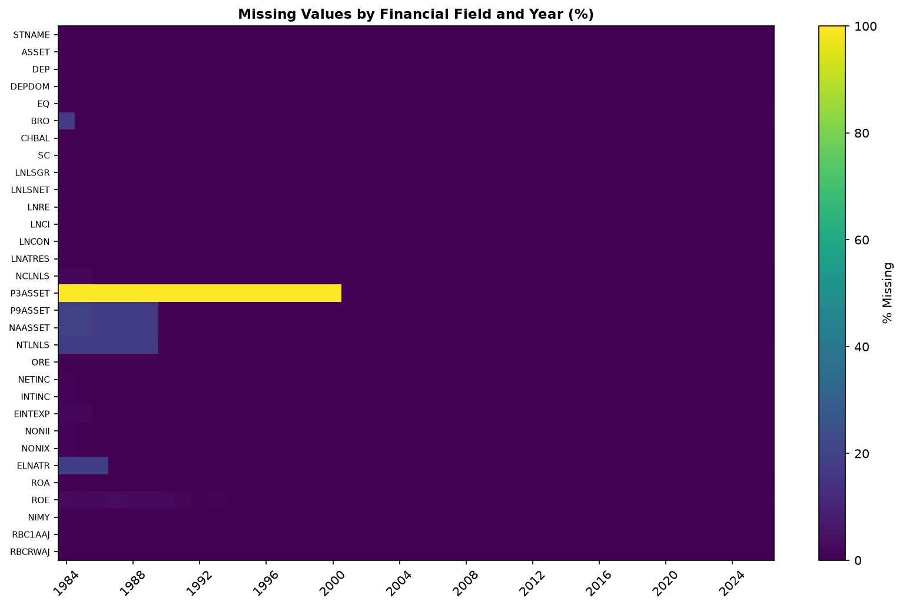
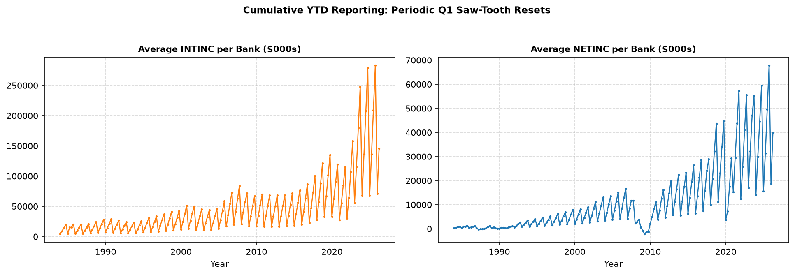

# NATIONAL ECONOMICS UNIVERSITY
## BFT65B – BIG DATA ANALYTICS IN FINANCE
### FINAL INDIVIDUAL RESEARCH REPORT: A BIG-DATA PIPELINE FOR BANK FAILURE EARLY WARNING

---

* **Author**: Hứa Văn Phúc
* **Student ID (MSSV)**: 11231006
* **Cohort / Class**: BFT65B – Big Data Analytics in Finance
* **GitHub Repository URL**: https://github.com/hvphuc05/FDIC_Bank_Failure_EWS
* **Data Ingestion Date**: 2026-11-08 / 2026-11-09
* **Acquisition Methodology**: FDIC Public BankFind API (Automated, Resumable Python Pipeline with SHA-256 Checksums)
* **Dataset Scope**: 1984Q1 to 2026Q2 (170 Quarters)
* **Verified Row Counts**:
  * Financial Call Reports (`financials`): 1,682,616 rows across 24,064 distinct bank charters
  * Bank Structure & Event Directory (`institutions`): 27,835 records
  * Failure Registry (`failures`): 4,117 records
* **Modelling Scope**: bank-quarters 1984Q1 – 2025Q2 carry a complete 4-quarter label; 2025Q3 – 2026Q2 (17,529 rows) stay in the panel with a null label (`split = unlabeled`)
* **Development Period**: REPDTE 1984Q1 – 2006Q4 — 1,193,818 bank-quarters, 8,688 positive rows, **2,290 failed banks** (2,299 `FAILURE` records with failure date in 1984-04-01 .. 2007-12-31)
* **Purged Gap**: 2007Q1 – 2007Q4 (34,754 rows, 48 positive rows), excluded from development and from test
* **Test Period (out-of-time)**: REPDTE 2008Q1 – 2025Q2 — 435,446 bank-quarters, 2,134 positive rows, **545 failed banks** (545 `FAILURE` records with failure date in 2008-04-01 .. 2026-06-30). Evaluated once, after the design is frozen (§6.7)

---

# 1. Executive Summary & Context

**Answers in brief.** **Q1 (storage and processing).** Typed Parquet with ZSTD halves the size of the raw CSV (174.1 MB against 350.1 MB) and, partitioned by year, reads one quarter about 70 times faster; Polars in lazy mode processes the whole 42-year panel on an 8 GB laptop in under two seconds for each of the two core transformations measured, and Spark in local mode was 3.8 to 12.6 times slower on the same machine, so a cluster is not justified at this size (§4.7). **Q2 (quality and look-ahead bias).** The audit found problems in the target, the exits and the income statement (year-to-date flows, assistance versus failure, 1,069 post-failure filings, 16,541 exits that are not failures); each is handled by a rule that uses only information available at the quarter being scored, and the label logic is checked by independent recomputations (§3, §4.6). **Q3 (validation).** The output supports an honest evaluation: with time-ordered purged validation, rules registered before the test period, and one logged test run, the frozen logistic regression reached a PR-AUC of 0.61 and a ROC-AUC of 0.984 on 2008Q1–2025Q2, and saved 49% to 82% of the cost of never alerting under the assumed cost ratios; the limits are stated in §7.4.

---

# 2. Part 1: Data Acquisition & Storage Layout Design

## 2.1 Reproducible Acquisition Architecture & Verification

In bank failure early-warning systems, regulatory integrity demands that the ingestion pipeline is fully reproducible, deterministic, and verifiable. Using the public FDIC BankFind Suite API, an automated, resumable extraction pipeline was implemented (`src/01_download.py`) covering the complete temporal scope specified by the supervisory authority: **1984Q1 to 2026Q2 (170 consecutive quarters)**.

To prevent transient network failures or abrupt process interruptions from corrupting the local repository, the acquisition engine implements three core engineering safeguards:
1. **Resumable Manifest Auditing**: An atomic cryptographic ledger (`manifest.json`) records the status, row count, API-reported `meta.total`, and SHA-256 hash digest of each quarterly batch. Any previously downloaded quarter that matches its cryptographic signature is skipped upon re-execution.
2. **Atomic Ingestion Commits**: Data payloads are staged to a temporary file (`.parquet.tmp`) and only committed to the persistent directory via an atomic filesystem rename (`os.replace`) once schema conformance, row counts, and duplicate primary keys `(CERT, REPDTE)` are strictly verified.
3. **Rate Limiting & Exponential Back-Off**: Network requests observe HTTP 429 and 5xx status codes, automatically honoring regulatory `Retry-After` headers and decaying politely with exponential back-off up to 6 retry attempts.

### Ingestion Audit & Data Quality Findings
An offline, zero-network integrity audit (`python src/01_download.py --verify-only`) was conducted across all on-disk artifacts:
* **Call Reports (`financials`)**: Exactly **1,682,616 records** across **24,064 distinct bank charters (`CERT`)** were verified with zero row count discrepancies against API totals and zero duplicate primary keys.
* **Institution Structure (`institutions`)**: 27,835 chartered entity records.
* **Failure Registry (`failures`)**: 4,117 historical failure events dating from 1934 to 2026.
  * *Audit insight*: 488 failure records have a null `CERT`, and all of them are dated before 1984. **All failure records inside the study scope (1984 onwards) have a non-null `CERT`**, so the label suffers no attrition from missing identifiers. 44 non-null `CERT` values are repeated in the full registry; `ID` is used as the surrogate primary key, and the repeated charters inside the scope are analysed in §3.1.4.

---

## 2.2 Schema Mismatch Audit & Lossless Typed Storage Design

A systematic inspection of the 170 raw quarterly Call Report Parquet files (`check_schema.py`) uncovered a critical data quality challenge: **schema heterogeneity across quarters**. Because the FDIC API dynamically serializes numeric values:
* Financial balance-sheet amounts (e.g., `DEP`, `CHBAL`, `LNLSGR`) fluctuate between `int64` and `double` across different reporting periods depending on whether integer rounding was applied by filing institutions.
* Some indicators (for example `P3ASSET`) are entirely null in early years (first non-null year 2001), so naive schema inference assigns a `null` type rather than a numeric type.
* Report dates (`REPDTE`) are natively returned as unstructured strings (`large_string`).

Naively concatenating these raw files triggers Arrow schema mismatch exceptions or coerces all numeric fields into 64-bit floating point numbers (`float64`), which bloats memory consumption and introduces potential IEEE 754 precision issues.

To resolve this without look-ahead bias, an explicit **Unified Typed Schema** was designed:
1. `REPDTE` is cast to `date32` (saving 75% memory compared to string representation).
2. `CERT` is verified to reside within $[-2^{31}, 2^{31}-1]$ (maximum observed: 91,325) and safely cast to `int32`.
3. Financial amounts in thousands of USD are verified to contain exclusively whole numbers and safely cast to `int64`.
4. Regulatory ratios (`ROA`, `ROE`, `NIMY`, `RBC1AAJ`, `RBCRWAJ`) are retained as `float64`.

**Mathematical Verification**: The transformation is strictly lossless. A column-by-column fingerprint check comparing the null counts, distinct counts, and sum of values before and after type casting confirmed **zero data loss (`exact_equal_to_reference = True`)**.

---

## 2.3 Storage Layout Benchmark & Empirical Measurements

To quantitatively evaluate storage efficiency and analytical query latency, six layout architectures were benchmarked on a standard supervisory workstation (Intel Core i5-10210U @ 1.60GHz, 8.0 GB RAM, Windows 11). Each read/write operation was measured over 5 timed iterations following an untimed warm-up pass to eliminate operating system cache warm-up variance (`src/02_storage_benchmark.py`).

### Table 1: Empirical Storage Benchmark Results (1.68M Rows, 33 Columns)
| Storage Layout | Format & Details | Files | Size (MB) | vs CSV | Write Time (s) | Full Scan (s) | Read 5 Cols (s) | Read 1 Qtr (s) |
|:---|:---|:---:|:---:|:---:|:---:|:---:|:---:|:---:|
| **1. Raw CSV** | Uncompressed Text | 1 | 350.1 MB | 1.00x | 7.20s | 1.60s | 0.617s | 1.655s |
| **2. Parquet Naive** | Snappy, all float64 | 1 | 211.7 MB | 0.60x | 10.27s | 0.589s | 0.117s | 0.032s |
| **3. Parquet Typed** | Snappy, optimized types | 1 | 205.9 MB | 0.59x | 10.33s | **0.548s** | **0.085s** | 0.033s |
| **4. Parquet Typed** | ZSTD, optimized types | 1 | **174.1 MB** | **0.50x** | 10.25s | 0.697s | 0.125s | 0.064s |
| **5. Parquet Partitioned** | ZSTD, partitioned by `YEAR` | 43 | 181.6 MB | 0.52x | **3.18s** | 0.610s | 0.103s | **0.023s** |
| **6. Parquet Partitioned** | ZSTD, partitioned by `QUARTER` | 170 | 189.6 MB | 0.54x | 3.51s | 0.709s | 0.181s | 0.029s |

*Figure 1: Comparison of Disk Footprint and Query Latency across Storage Layouts (Log Scale).*

### Technical Justification & Analysis (Addressing Question Q1)
The empirical measurements demonstrate why raw CSV is wholly unsuitable for central bank early-warning systems, and validate our recommended production architecture:
1. **Compression & Storage Footprint**: Uncompressed CSV requires 350.1 MB. Switching to Typed Parquet with **Zstandard (ZSTD)** compression reduces the disk footprint to **174.1 MB (a 50% storage saving)** due to dictionary encoding, bit-packing, and run-length encoding on homogeneous columnar blocks.
2. **Column Pruning Efficiency**: Early-warning screening algorithms frequently evaluate risk subsets rather than entire balance sheets. Querying 5 key financial indicators (`CERT`, `REPDTE`, `ASSET`, `NETINC`, `ROA`) on Parquet Typed Snappy takes **0.085 seconds — a 7.3x speedup over CSV (0.617s)**. CSV forces the engine to read and tokenize all 33 columns line-by-line, whereas Parquet reads only the targeted column chunks directly from disk.
3. **Partition Pruning (Predicate Pushdown)**: When supervisory inspectors query a specific crisis period (e.g., Q4 2008), the **Year-Partitioned Parquet layout executes in 0.023 seconds, outperforming CSV by over 70x (1.655s)**. The query engine uses folder-level metadata to completely bypass 42 unrelated year directories without loading a single superfluous byte into RAM.

**Preliminary conclusion for Q1 (storage)**: Four decades of quarterly Call Reports (~1.68 million rows) can be stored in under **185 MB** and queried in milliseconds on an ordinary commodity laptop using **Year-Partitioned Parquet with ZSTD compression**. At this volume a distributed cluster is not needed for storage or for simple queries; the scaling argument for the processing steps is made from measurements in Part 3.

---

# 3. Part 2: Data Quality Audit & Clean Panel Construction

## 3.1 Automated Data-Quality Audit & Empirical Findings

An automated, non-destructive audit (`src/03_quality_report.py`, about 11 seconds for all 170 quarters on the author's laptop) inspects the 170 quarterly Call Reports, the 4,117 failure records and the 27,835 institution records. It follows a **measure-only** mandate: no raw record is dropped, clipped or modified. All numbers below are produced by that audit (`report/dq_report.md`, `report/dq_*.csv`) or by the read-only diagnostic scripts listed in the README (`src/diagnostics/`); each is stated with the script that produced it.

### 3.1.1 Panel structure

| Item | Value |
|:---|---:|
| Bank-quarter rows | 1,682,616 |
| Distinct bank charters (`CERT`) | 24,064 |
| Quarters | 170 (1984Q1 – 2026Q2) |
| Banks per quarter (min – max) | 4,313 – 18,133 |
| Duplicate keys `(CERT, REPDTE)` / null `CERT` | 0 / 0 |
| Banks with internal reporting gaps | 32 (92 missing bank-quarters) |
| Single-quarter reporters | 204 |
| Banks that stop reporting before 2026Q2 | 19,751 |
| Banks still reporting in 2026Q2 | 4,313 |

Only 32 banks (0.13%) have internal gaps, so missing quarters are **not** interpolated; every lag or growth feature is computed on calendar dates (`REPDTE`), never on row offsets.

*Figure 2: Active bank population and exits, 1984Q1 – 2026Q2.*

### 3.1.2 Temporal missingness

*Figure 3: Share of null values by indicator and year.*

The audit shows that some indicators are null for entire early periods. `P3ASSET` has no non-null value before 2001 (100% null in the first panel year). `P9ASSET` and `NAASSET` are 19.2% null in 1984, `BRO` 17.7%, and `NTLNLS`/`ELNATR` 18.5%. We state only the observation; we do not attribute it to a specific regulation because the FDIC dictionary does not say so. **Handling:** structural nulls are never back-filled with later values (that would be look-ahead). `P3ASSET` is excluded from the feature set because it is missing for most of the development period (§5); the remaining nulls are handled by an imputer fitted on the development sample only (§5.3).

### 3.1.3 Year-to-date (YTD) structure of income-statement items

Candidate flow variables were tested against `ASSET` (a stock, used as a negative control) on bank-years with four complete quarters.

**Table 2: Within-year behaviour of candidate flow variables** (`report/dq_ytd_evidence.csv`, `check_ytd_extra.py`)

| Variable | Complete bank-years | Share with Q1≤Q2≤Q3≤Q4 | Median \|Q2\|/\|Q1\| | Median \|Q3\|/\|Q1\| | Median \|Q4\|/\|Q1\| |
|:---|---:|---:|---:|---:|---:|
| NETINC | 407,328 | 76.64% | 2.05 | 3.12 | 4.08 |
| INTINC | 407,328 | 99.52% | 2.02 | 3.06 | 4.11 |
| EINTEXP | 407,068 | 99.51% | – | – | 4.05 |
| NONII | 407,328 | 96.60% | – | – | 4.26 |
| NONIX | 407,328 | 99.45% | – | – | 4.16 |
| ELNATR | 397,938 | 91.24% | – | – | 4.33 |
| NTLNLS | 389,153 | 59.47% | 1.83 | 3.00 | 5.14 |
| ROA | 408,605 | – | 1.01 | 1.02 | 0.99 |
| ROE | 404,298 | – | 1.01 | 1.01 | 0.99 |
| NIMY | 408,605 | – | 1.01 | 1.01 | 1.01 |
| ASSET (control) | 408,605 | 33.12% | 1.01 | 1.02 | 1.04 |

("–" = not measured in that script.) The seven income-statement variables follow the pattern expected from a cumulative year-to-date series (ratios close to 2, 3 and 4 against Q1); `ROA`, `ROE`, `NIMY` and the control `ASSET` do not (ratios close to 1) and are kept as reported. `NTLNLS` shows ratios 1.83 and 3.00 for Q2 and Q3 and 5.14 for Q4; we treat it as YTD-like but note that its Q4 ratio exceeds 4 and that it is the least clean of the seven (see P15 below). `YTD_FLOW_COLUMNS` in `config.py` lists the seven variables.

*Figure 4: Saw-tooth of cumulative flows versus the stock control.*

**Consequence.** Unadjusted YTD flows are about four times larger in Q4 than in Q1, so any ratio built from them would drift with the calendar quarter. Step 04 converts them to single-quarter values (§3.2).

### 3.1.4 Failure registry, linkage and post-failure filings

The registry holds 4,117 records (3,524 `FAILURE`, 593 `ASSISTANCE`), of which **3,273 fall inside the study scope** (1984-01-01 to 2026-06-30): 2,861 `FAILURE` and 412 `ASSISTANCE`. All 3,273 have a non-null `CERT` (the 488 null `CERT` values in the registry all pre-date 1984). **3,251 events link to the panel; 22 do not** (21 `FAILURE`, 1 `ASSISTANCE`; `src/04_build_panel.py`, stage 4). The reason for these 22 has not been established, and we do not assert one. They carry no panel rows, so they can never become positive labels; this is a recall ceiling of 21 failures out of 2,861 (0.7%).

**What the `RESTYPE` field contains.** `ASSISTANCE` concentrates in 1984–1988 (389 of 412 records; 238 in 1988 alone), with 13 in 2008–2009 and 10 in 1989–1992. Of 411 `CERT`s that received assistance, only 31 later appear as `FAILURE`; 380 (92.5%) never do. Since the assignment defines the label as "bank fails", we label only `RESTYPE = FAILURE` as 1 (decision D1, §3.2).

**Repeated `CERT`s inside the scope** (`check_failures_detail.py`, Section 4): 35 `CERT`s occur twice (70 rows): 31 `ASSISTANCE→FAILURE`, 3 `FAILURE→FAILURE`, 1 `ASSISTANCE→ASSISTANCE`. The three `FAILURE→FAILURE` charters (29400, 31927, 32059) have `COST` missing on the earlier record and keep filing until after the second date. We do not interpret the earlier records; the pipeline censors each `CERT` at its **last** `FAILURE` date and labels a row positive if **any** `FAILURE` date falls in its window.

**Filings dated after the event.** Table 3 classifies the 3,251 linked events by the gap between the last report and the event date (`report/dq_report.md`).

**Table 3: Last Call Report relative to the recorded event date (3,251 linked events)**

| Interval | Events | Share |
|:---|---:|---:|
| Report dated after the event date | 439 | 13.5% |
| 0–92 days before | 2,472 | 76.0% |
| 93–184 days before | 330 | 10.2% |
| 185–366 days before | 10 | 0.3% |
| More than 366 days before | 0 | 0.0% |

Of the 439, 169 are `ASSISTANCE` and 270 are `FAILURE` records (`check_failures_detail.py`, Section 5). For the 270 `FAILURE` records we tested the hypothesis that the `CERT` was re-issued to a new institution: **0 of 270** have an establishment date (`ESTYMD`) later than the failure date, so the hypothesis is not supported. These post-event reports are genuine filings (all 1,104 rows after the failure date of `FAILURE` records have `ASSET > 0`; `check_failures_detail3.py`). We do not know why they exist and make no claim about it; we simply do not allow them into the panel. With the comparison `REPDTE ≥ FAILDATE` (so a report dated on the failure date is also removed), the event counts become 271 `FAILURE` and 176 `ASSISTANCE` records, and the rule removes **1,069 bank-quarter rows** (0.064% of the panel) after censoring each `CERT` at its last `FAILURE` date.

> **Leakage gate.** A report filed on or after a bank's failure date contains information that would not exist when predicting that failure. Step 04 therefore removes every row with `REPDTE ≥` the last `FAILURE` date of the same `CERT`, and an independent pandas recomputation confirms that no such row remains (§3.2).

### 3.1.5 Exit classification: failure versus other exits

Of the 24,064 charters, 19,751 stop reporting before 2026Q2. Classifying them with the *same* rule as the label (`FAILURE` record present or not) gives (`bank_exits.parquet`, stage 4):

**Table 4: Classification of the 24,064 charters**

| Class | Banks | Share of the 19,751 exits |
|:---|---:|---:|
| Exited, has a `FAILURE` record | 2,837 | 14.4% |
| Exited, `ASSISTANCE` record only | 373 | 1.9% |
| Exited, neither record | 16,541 | 83.7% |
| Still reporting in 2026Q2 | 4,313 | – |

The 2,858 `CERT`s with a `FAILURE` record reconcile as 2,837 exited + 0 still reporting + 21 absent from the panel. The first version of the audit counted 3,210 "confirmed failures"; this equals 2,837 + 373, i.e. it also counted the assistance-only banks. The audit code (`exit_analysis`) was corrected to filter on `RESTYPE`, and the numbers above are from the corrected run.

As an empirical cross-check only, we tabulated the `CHANGEC1` code of the exited banks. Among banks with a `FAILURE` record, 83.7% carry code 211 (2,374 of 2,837), while 85.1% of the "neither record" banks carry code 223 (14,081 of 16,541), and **no** `FAILURE` charter carries 223. However, 468 of the 2,858 `FAILURE` charters (16.4%) carry a code other than 211, so the code cannot replace the failure registry as a label source. We do not interpret the codes, and `CHANGEC1`, `ACTIVE` and `ENDEFYMD` are never used as features. (`ACTIVE` and `ENDEFYMD` are even mutually inconsistent for 22 banks that have `ACTIVE = 0` and `ENDEFYMD = 12/31/9999`.)

**Decision D2 (no right-censoring of mergers).** The "neither record" banks keep **all** their rows with y = 0 ("mergers are not failures"). An earlier design right-censored the four quarters before a merger. It was dropped: at quarter *q* an examiner cannot know that a bank will merge within a year, so deleting those rows would use future information, flatter the evaluation (survivorship bias) and risk the leakage-gate penalty. What must be avoided is labelling such exits as failures, and that is guaranteed by building the label from the failure registry alone.

### 3.1.6 Problem register

The register generated by the audit (`report/dq_problem_register.csv`, verbatim there) is **summarised** below with shortened wording; the P07 evidence cell is annotated with the Step-04 count (see P11 and the open reconciliation in the next subsection).

**Table 5: Problem register P01–P10 (automated audit)**

| ID | Area | Problem | Evidence | Handling | Rationale |
|:---:|:---|:---|:---|:---|:---|
| P01 | Schema | Cross-quarter data type discrepancies | 14 of 33 columns have heterogeneous types (int64/double/null) | Lossless unified typed schema (Step 02) | Avoids memory bloat and Arrow errors without changing values |
| P02 | Missing values | Structural missingness from late variable inception | `P3ASSET`: first available 2001 | Preserve structural nulls; imputers fitted on training data only | Back-filling older periods with modern values is look-ahead |
| P03 | Income statement | Cumulative YTD flows | Median \|Q4\|/\|Q1\| ≈ 4 with Q1 resets for NETINC, INTINC, EINTEXP, NONII, NONIX, ELNATR | Within-year de-cumulation in Step 04; Q1 kept as reported | Avoids mixing multi-quarter flows with single-quarter stocks |
| P04 | Continuity | Internal reporting hiatuses | 32 banks, 92 missing bank-quarters | No imputation; features use calendar dates | Avoids growth rates across non-consecutive intervals |
| P05 | Accounting rules | Rule violations (negative balance items etc.) | R04 96 rows; R05 2; R07 32; R08 6; R09 2; R11 9; R12 3; R15 2; R16 646; R18 2 | Flag; invalid denominators to NaN; keep `EQ ≤ 0` (15,683 rows) | Dropping near-insolvent banks causes survivorship bias |
| P06 | Target linkage | Failure records unmatched to the panel | 0 null `CERT`; 22 unmatched in scope | Audit unmatched records; document reason | Avoids treating failed institutions as healthy |
| P07 | Target definition | Several failure records per charter | 77 in-scope rows with a repeated `CERT` (audit); 70 rows / 35 `CERT`s in Step-04 diagnostics (see P11) | `ID` as surrogate key; chronological linking | Captures repeated transactions without key collisions |
| P08 | Leakage | Filings after the recorded failure date | 439 linked events | Censor rows with `REPDTE ≥` last `FAILURE` date (Step 04) | Removes post-failure information |
| P09 | Exit resolution | Exits without a `FAILURE` record | 16,541 banks | Keep all rows, y = 0; no right-censoring | Non-failure exits must not be positives; future-dependent row deletion would bias the test |
| P10 | Leakage | Terminal-status fields in Institutions | Current status, 27,835 records | Used only for exit cross-checks; never a feature | Terminal status as input triggers the leakage gate |

### 3.1.7 Additional findings from Step 04 diagnostics (P11–P18)

**Table 6: Findings added while building the panel**

| ID | Finding | Evidence (script) | Handling |
|:---:|:---|:---|:---|
| P11 | Three charters have two `FAILURE` records, one charter has two identical `ASSISTANCE` costs | CERT 29400, 31927, 32059; CERT 28448 repeats COST 51,543.68 (`check_failures_detail2.py`) | Censor at last `FAILURE`; label if any `FAILURE` date is in the window; de-duplicate (CERT, COST) |
| P12 | `ASSISTANCE` is not failure | 411 charters assisted, 31 later `FAILURE` (7.5%) | y = 1 only for `FAILURE`; assistance used for a sensitivity label only |
| P13 | `COST` unreliable as a plain number | Among 2,861 `FAILURE`: 23 null, 55 equal to 0; 20 of the 55 are 1992 records preceded by an `ASSISTANCE` of the same charter | Null/0 treated as missing; the 20 take the earlier assistance cost; 35 zeros remain unexplained and are excluded from the cost mean |
| P14 | Reports on or after the last `FAILURE` date | 1,069 rows removed (0.064%) | Row removal with an independent check (§3.2) |
| P15 | Imperfect de-cumulation of `NTLNLS` | Median \|Q4\|/\|Q1\| is still 1.66 after de-cumulation (other six variables 1.03–1.10) | Reported as a limitation; no explanation is asserted |
| P16 | Rows that cannot be de-cumulated | 4,635–5,278 rows per variable become null; for `NETINC` 4,712 are first-ever reports in Q2–Q4, 25 have a missing previous-quarter row, 541 have a null previous value (`check_gap_rows.py`) | Left null, not imputed |
| P17 | Negative single-quarter values after de-cumulation | INTINC 2,232, EINTEXP 2,253, NONIX 2,616 rows (accounting-implausible); NETINC 197,512 and NTLNLS 329,037 (plausible) | Kept as is; not clipped |
| P18 | Institutions fields inconsistent | 22 banks `ACTIVE = 0` with `ENDEFYMD = 12/31/9999`; 468 `FAILURE` charters not coded 211 | Fields excluded from features and from label construction |

**Open reconciliation:** P07 (audit: 77 rows) and the Step-04 diagnostic (70 rows, 35 charters) use different counting windows; the diagnostic figure is the one used in the pipeline. The exact source of the 7-row difference has not been traced yet.

## 3.2 Clean panel construction and point-in-time target design (`src/04_build_panel.py`)

The builder runs in four resumable stages (`--from-stage k`). All stages use Polars lazy scans except the small tables in stage 1 and 4.

### 3.2.1 Design decisions D1–D4

| # | Decision | Rule | Evidence |
|:---:|:---|:---|:---|
| D1 | Label for `ASSISTANCE` | y = 1 only if a `RESTYPE = FAILURE` record has FAILDATE in (REPDTE, REPDTE + 12 months]; assistance is neither censored nor excluded; an alternative label (`FAILURE` or `ASSISTANCE`) is stored for sensitivity | 380 of 411 assisted charters never fail; the assignment says "fails" |
| D2 | Censoring | Drop rows with `REPDTE ≥` the last `FAILURE` date of the same `CERT`; mergers are not censored | §3.1.4, §3.1.5 |
| D3 | `COST` | Never a feature; used only in Part 5, only for failures in the development window; null/0 = missing; 20 rows use the earlier assistance cost | P11, P13 |
| D4 | Out-of-time split | Development REPDTE ≤ 2006Q4, gap 2007Q1–2007Q4, test 2008Q1–2025Q2; quarters after 2025Q2 keep label null | Labels look ahead 12 months, so 2025Q3 onwards are incomplete |

### 3.2.2 Stage 1: failure events

`failure_events.parquet` holds the 3,273 in-scope records with a `cost_status` flag.

| cost_status | FAILURE | ASSISTANCE |
|:---|---:|---:|
| reported | 2,783 | 385 |
| from_prior_assistance | 20 | 0 |
| zero | 35 | 8 |
| missing | 23 | 19 |

2,858 `CERT`s have a `FAILURE` record (3 with two). 2,254 development-window failures have a usable `COST` (`use_for_cost_dev`); the development window contains 2,299 failure records, so 45 have none.

### 3.2.3 Stage 2: de-cumulation

For each variable, the quarterly value is the YTD value minus the YTD value of the previous quarter **of the same `CERT` in the same calendar year** (found by a calendar join, not a row shift); Q1 is kept as reported; a missing previous quarter gives null. Only quarters *q* and *q−1* are used, so no information flows from the future. The stage ingests all 170 files with a forced common schema and checks the result: 1,682,616 rows, 0 duplicate keys, REPDTE months {3, 6, 9, 12}, null accounting `null_q = null_ytd + gap_rows` (asserted for all seven variables).

| Variable | null YTD | null quarterly | rows not de-cumulable | negative quarterly |
|:---|---:|---:|---:|---:|
| NETINC | 4,692 | 9,970 | 5,278 | 197,512 |
| INTINC | 4,692 | 9,970 | 5,278 | 2,232 |
| EINTEXP | 6,437 | 11,072 | 4,635 | 2,253 |
| NONII | 4,692 | 9,970 | 5,278 | 20,581 |
| NONIX | 4,692 | 9,970 | 5,278 | 2,616 |
| ELNATR | 43,166 | 48,192 | 5,026 | 55,952 |
| NTLNLS | 79,918 | 84,696 | 4,778 | 329,037 |

**Effect.** The saw-tooth disappears: median |Q2|/|Q1|, |Q3|/|Q1|, |Q4|/|Q1| fall from 2.05/3.12/4.08 (NETINC) to 1.06/1.07/1.04, from 2.02/3.06/4.11 (INTINC) to 1.02/1.03/1.05, and similarly for the others; `NTLNLS` ends at 1.00/1.00/1.66 (P15).

### 3.2.4 Stage 3: label, censoring, split

The label is built by a join of the panel with the failure events and a window filter, then checked by an independent pandas recomputation that does not reuse the Polars label code.

* Rows before / after censoring: 1,682,616 / 1,681,547 (1,069 removed).
* **Check 1:** rows with `REPDTE ≥` last `FAILURE` date still present: **0**.
* **Check 2:** label mismatches against the pandas recomputation: **0** (88,427 rows checked).
* Failure records by label window: development 2,299, test 545, in neither window 17 (FAILDATE in 1984Q1 or 2008Q1).

**Table 7: Split summary** (`report/panel_split_summary.csv`)

| Split | Rows | Banks | First – last quarter | Positive rows | Positive rate | Banks with ≥1 positive | Positive rows, alt. label |
|:---|---:|---:|:---|---:|---:|---:|---:|
| dev | 1,193,818 | 23,624 | 1984Q1 – 2006Q4 | 8,688 | 0.728% | 2,290 | 10,225 |
| gap | 34,754 | 8,892 | 2007Q1 – 2007Q4 | 48 | 0.138% | 27 | 53 |
| test | 435,446 | 8,798 | 2008Q1 – 2025Q2 | 2,134 | 0.490% | 545 | 2,181 |
| unlabeled | 17,529 | 4,461 | 2025Q3 – 2026Q2 | null | null | null | null |

The four splits add to 1,681,547 rows. Because four overlapping 4-quarter windows share one failure, 8,688 positive rows correspond to only 2,290 banks (about 3.8 rows each); **the effective sample size is the number of banks, not rows**. The test period has 545 failed banks, far above the minimum of 50 required by the assignment. A limitation to state: only 73 `FAILURE` records have a failure date in 1994–2007 (this is exactly the number of failed banks in the third validation fold, §6.2), so the development period learns mostly from the 1980s crisis, a different mechanism from 2008.

### 3.2.5 Stage 4: exit table

`bank_exits.parquet` (24,064 rows) classifies each charter as in Table 4. Outcome information lives only in `failure_events.parquet` and `bank_exits.parquet`; none of their columns is a feature.

---

# 4. Part 3: Scalable Processing with Polars & PySpark

## 4.1 Scope and method

The core transformations of the pipeline are implemented in Polars lazy mode: de-cumulation of year-to-date flows (T1, `src/04_build_panel.py`, stage 2), forward-label construction with censoring (T2, stage 3) and feature ratios with a calendar lag (T3, `src/07_features.py`). This chapter benchmarks **T1**, the first and most data-intensive transformation: a self-join of the panel on `(CERT, year, quarter)` that subtracts the previous quarter's year-to-date value (§3.2.3). T2 is benchmarked in §4.6; T3 is not.

| Environment | Hardware | Software |
|:---|:---|:---|
| Laptop | Intel Core i5-10210U @ 1.60 GHz, 8 GB RAM, Windows 11 | Python 3.12.3, pandas 3.1.1, Polars 2.1.0 |
| Google Colab | 2 vCPUs | PySpark 4.0.5, Polars 1.35.2, OpenJDK 21.0.12.1 (build 21.0.12.1+1-1-24.04.4-Ubuntu), Python 3.13.18, pandas 2.2.3 |

The two environments use **different Polars versions** (2.1.0 and 1.35.2). The Polars 2.0 change that made the streaming engine the default (§4.2) implies that the default engine of 1.35.2 may be a different one; we did not test this, so Colab and laptop Polars results are not directly comparable.

**Benchmark design.** The input is a narrow table (`CERT`, `REPDTE`, seven YTD flows; 9 columns). Scale ×k is k copies of the panel with `CERT` shifted by 10 million, so keys stay unique (×1 = 1,682,616 rows, ×2 = 3,365,232, ×4 = 6,730,464). Each measurement runs in a **fresh subprocess**. Time covers reading the Parquet file and computing the result. Memory is the peak working set of the process on Windows and the peak resident set (`ru_maxrss`) on Linux; the two are not comparable across operating systems. Results are the median of 7 runs with the minimum and maximum, unless stated. Three implementations of the same task were compared: Polars (lazy), pandas with a merge on `(CERT, year, quarter)` (same algorithm), and pandas with `groupby().diff()` (a common row-based idiom, **not** identical: it differs on 10 rows, 9 for `ELNATR` and `NTLNLS`, where the previous quarter's row is missing).

**Correctness.** Before any timing, the three exact implementations were compared with the output of step 04 on all 1,682,616 rows and 7 variables: Polars against step 04, pandas against step 04, and Polars against pandas all show 0 null-pattern mismatches and a maximum absolute difference of 0.0. These checks are assertions in `--verify`.

## 4.2 How Polars executes T1

`LazyFrame.explain()` (`report/polars_plan_T1_*.txt`) shows what the optimiser does with the query:

| Observation in the plan | Interpretation |
|:---|:---|
| The unoptimised plan has **two** `Parquet SCAN` nodes (one per side of the self-join); the optimised plan has **one** scan below a `CACHE` node that both sides of the join reference | The file is read, and the year and quarter columns are computed, only once and shared |
| The condition `q == 1` used by all seven `when/then/otherwise` expressions is replaced by one shared expression (`__POLARS_CSER_…`) | Common sub-expression elimination: it is evaluated once instead of seven times |
| Every scan shows `PROJECT */9 COLUMNS` | All nine columns are needed, so projection pushdown gives no saving; there is no filter, so no predicate pushdown either |
| The plan printed for `engine="streaming"` is identical to the optimised plan apart from the cache identifier | The plan text does not show which engine will run it; the engines have to be compared by measurement |

`LazyFrame.profile()` is not available in the installed Polars 2.1.0 (it raises an error stating that it was removed in version 2.0 and that the streaming engine is now the default). A stage-by-stage timing was used instead (median of 3, ×4 data; the stages are separate queries, so the times are not additive):

**Table P3-1: Stage timing, Polars 2.1.0, ×4**

| Stage | Seconds |
|:---|---:|
| S0 metadata only (row count) | 0.001 |
| S1 read and decode all 9 columns | 0.282 |
| S2 + year and quarter columns | 0.374 |
| S3 + self-join on `(CERT, year, quarter)` | 1.630 |
| S4 full query (+ 7 de-cumulated columns) | 1.724 |

The step from S2 to S3 (1.26 s) is about **73%** of the full query (1.724 s); reading and decoding is about 16%. The join is the dominant cost.

**Engine choice.** Because the default engine is the streaming engine, an explicit in-memory run was added. At ×4: default 1.67 s and 1,759 MB, in-memory 2.35 s and 3,430 MB (the interleaved sweep, in another session, gives 1.71 s versus 2.02 s and 1,756 versus 3,428 MB). The default engine uses about half the peak memory and is 15–29% faster. `polars_lazy` and `polars_streaming` are indistinguishable in every run, which agrees with the default being the streaming engine.

## 4.3 Benchmark against pandas (laptop)

**Table P3-2: Laptop, median of 7 runs [min – max]**

| Scale | pandas (merge) | pandas (groupby-diff) | Polars (default) | Polars (in-memory) |
|:---|:---|:---|:---|:---|
| ×1 time (s) | 0.64 [0.61–0.83] | 0.92 [0.90–0.96] | 0.46 [0.45–0.65] | 0.55 [0.53–0.67] |
| ×1 peak (MB) | 634 | 569 | 689 | 954 |
| ×2 time (s) | 1.14 [1.12–1.40] | 1.77 [1.75–2.46] | 0.93 [0.90–0.97] | 1.14 [1.03–1.25] |
| ×2 peak (MB) | 1,126 | 1,017 | 1,058 | 1,777 |
| ×4 time (s) | 2.05 [1.95–2.08] | 3.13 [3.08–3.59] | 1.67 [1.65–1.71] | 2.35 [2.06–3.31] |
| ×4 peak (MB) | 2,110 | 1,888 | 1,759 | 3,430 |

* **Time.** Both pandas variants are slower than default Polars at every scale; the pandas merge is the stronger baseline. Polars is about 1.2–1.3 times faster than the pandas merge at ×2 and ×4. Across four measurement sessions the ratio at ×4 was 1.28, 1.34, 1.23 and 1.11, so the advantage is real but modest and varies by session. **Absolute times differ between sessions by up to about 20%** (pandas ×4: 2.53, 2.05, 1.90 s), so only comparisons within one session are used. The `groupby().diff()` idiom is 1.4–1.6 times slower than the pandas merge.
* **Memory.** Polars is not lower at every scale: higher than the pandas merge at ×1 (+9%), lower by 17% at ×4. Between ×2 and ×4 the slope is about 208 MB per million rows for default Polars, 292 for the pandas merge, 259 for groupby-diff and 491 for the Polars in-memory engine.
* **Scaling.** For all implementations, doubling the rows roughly doubles the time (Polars 0.46 → 0.93 → 1.67 s); nothing superlinear is visible up to 6.7 million rows.

**Table P3-3: Parallelism (interleaved runs, ×4, one session, median of 7)**

| Setting | Time (s) | Speed-up vs 1 thread | Peak (MB) |
|:---|---:|---:|---:|
| pandas (merge) | 1.90 | – | 2,107 |
| Polars, 1 thread | 3.08 | 1.00 | 1,512 |
| Polars, 2 threads | 2.04 | 1.51 | 1,545 |
| Polars, 4 threads | 1.69 | 1.82 | 1,618 |
| Polars, 8 threads | 1.70 | 1.81 | 1,751 |
| Polars, default (8-thread pool) | 1.71 | – | 1,756 |

With one thread Polars is 1.6 times *slower* than pandas in the same session (3.08 versus 1.90 s), and with two threads about equal; on this machine its advantage therefore comes from parallelism, not from faster single-thread code. Parallel efficiency falls from 75% (2 threads) to 46% (4) and 23% (8); going from 4 to 8 threads brings no gain, which agrees with a processor of 4 physical cores and 8 hardware threads (to be confirmed against the Intel specification). More threads also cost memory (+16% from 1 to 8 threads).

## 4.4 Benchmark on Google Colab (same machine as Spark)

**Table P3-4: Colab (2 vCPUs), median of 7 runs [min – max]; peak resident memory**

| Scale | pandas (merge) time (s) | Polars 1.35.2 time (s) | pandas peak (MB) | Polars peak (MB) |
|:---|:---|:---|---:|---:|
| ×1 | 1.48 [1.34–1.87] | 1.10 [1.07–2.12] | 1,068 | 735 |
| ×2 | 2.95 [2.54–4.10] | 2.24 [2.22–3.79] | 2,022 | 1,274 |
| ×4 | 6.90 [5.37–7.27] | 6.34 [4.75–13.08] | 3,602 | 2,382 |

On the shared Colab machine the runs are noisy (Polars ×4 ranges from 4.75 to 13.08 s). Polars is about 1.3 times faster at ×1 and ×2 and about 1.1 times at ×4, and its peak memory is 31–37% lower at all three scales. These figures use a different operating system, a different memory measure and a different Polars version from Table P3-2 and must not be compared with it.

## 4.5 PySpark reproduction

`src/06_spark_pipeline.py` implements the same T1 with the DataFrame API (calendar join on `(CERT, year, quarter)`). It ran on Colab in local mode (`local[*]`, default parallelism 2, Spark 4.0.5, Java 21.0.12.1, adaptive query execution on, broadcast threshold 10,485,760 bytes). The default-configuration result at ×1 was written to Parquet, downloaded and compared with the Polars result by `src/06b_compare_spark.py` on all 1,682,616 rows and 7 variables: **0 null-pattern mismatches, maximum absolute difference 0.0** (strict assertion; the check was done for the default configuration only).

**Reading the physical plan** (`spark_plan_T1_*.txt`, `explain("formatted")`):

* Each side of the join is `Scan parquet → Project (adds year and quarter; on the right side the quarter is shifted by one) → Exchange hashpartitioning(CERT, yr, q, N) → Sort`; the right side also has a `Filter` of null checks on the keys (the scan has `PushedFilters: [IsNotNull(CERT)]`). The join is a **`SortMergeJoin LeftOuter`** on three keys, followed by a `Project` with the same `CASE WHEN q = 1 …` logic as the Polars query.
* **The input file is scanned twice** (nodes 1 and 5); Polars' optimiser reads it once (§4.2).
* Spark **shuffles both inputs** (two `Exchange` nodes) and sorts them before merging. The default broadcast threshold of 10 MB did not lead to a broadcast join.
* With adaptive query execution on, the printed plan is the initial one (`isFinalPlan=false`), so run-time changes such as coalescing partitions are not visible. With it off, the plan shows whole-stage code generation in five stages separated by the two shuffles.
* The number of shuffle partitions is 200 by default (`hashpartitioning(..., 200)`), which is large for two cores.

**Table P3-5: Spark configurations, Colab, median [min – max] in seconds**

| Configuration | ×1 | ×4 |
|:---|:---|:---|
| Default (200 shuffle partitions, AQE on) | 9.52 [8.02–11.45] (5 runs) | 32.71 [30.97–34.87] (5 runs) |
| 8 shuffle partitions, AQE on | 8.31 [6.29–14.83] (3 runs) | 23.92 [22.85–25.95] (3 runs) |
| 8 shuffle partitions, AQE off | 7.47 [5.79–9.20] (3 runs) | not run |

Each default configuration was measured twice, in different sessions: ×1 gave 9.59 and 9.52 s, ×2 gave 17.47 and 18.21 s, ×4 gave 39.21 and 32.71 s; the later runs, made with the corrected script, are used in the tables, and the spread between the two runs (up to 17% at ×4) indicates the session-to-session noise. Reducing the partitions lowered the ×4 time by 27% relative to the later default run (32.71 → 23.92 s) and by 39% relative to the earlier one; at ×1 the differences between configurations (−13% and −22%) are within the spread of the runs and are not interpreted. Start-up of the Spark session took 10.2–13.8 s and the first run 18.2–20.5 s at ×1 (39.6 s at ×2, 41.1–43.5 s at ×4), against a median of 7.5–9.5 s at ×1. Other tuning (for example partitioning the input by `CERT`) was not explored.

**Table P3-6: Spark against Polars and pandas on the same Colab machine (seconds)**

| Scale | Spark default | Spark best measured | Polars 1.35.2 | pandas | Spark default / Polars | Spark best / Polars |
|:---|---:|---:|---:|---:|---:|---:|
| ×1 | 9.52 | 7.47 | 1.10 | 1.48 | 8.7 | 6.8 |
| ×2 | 18.21 | – | 2.24 | 2.95 | 8.1 | – |
| ×4 | 32.71 | 23.92 | 6.34 | 6.90 | 5.2 | 3.8 |

The ×2 and ×4 default times are from a rerun with the corrected script (an earlier run, whose JSON recorded the AQE flag wrongly because of an error in the script, gave 17.47 and 39.21 s). "Best measured" is 8 partitions with AQE off at ×1 and 8 partitions at ×4.

## 4.6 Transformation T2: forward label with censoring

T2 is stage 3 of step 04 (§3.2.4): drop every bank-quarter on or after the last `FAILURE` date of the same `CERT`, set y = 1 if a `FAILURE` date falls in (REPDTE, REPDTE + 12 months], build the alternative label from `FAILURE` and `ASSISTANCE` records, and leave the labels null after 2025Q2. The inputs are a key table (`CERT`, `REPDTE`; 1,682,616 rows) and the event table (3,273 rows). The range condition is implemented as an equality join on `CERT` followed by a filter; this is efficient here because a charter has at most two events in scope. Scale ×k is again k copies with `CERT` shifted by 10 million (keys and events of each copy stay together). Three implementations were written from the same specification: Polars lazy, pandas (a straightforward merge-and-filter formulation; a more specialised pandas implementation was not tried) and PySpark.

**Table P3-7: Correctness of T2**

| Check | Result |
|:---|:---|
| Polars, pandas and the panel written by step 04 (laptop, ×1, 1,681,547 rows; strict assertions) | 0 mismatches in `label_observable`, `y_fail_4q` and `y_assist_or_fail_4q` for Polars–step 04, pandas–step 04 and Polars–pandas |
| Positive rows | `y_fail_4q` 10,870 and `y_assist_or_fail_4q` 12,459, equal to the sums of Table 7 (dev + gap + test) |
| Non-null labels after the last labelable quarter | 0 |
| Spark (Colab, ×1): fingerprint | 1,681,547 rows; 10,870 and 12,459 positives; 1,664,018 observable rows (= 1,681,547 − the 17,529 unlabeled rows of Table 7) |
| Spark (×1) against Polars and against the step-04 panel, row by row (strict) | 0 mismatches in all three label columns |
| Spark (×4) | counts are exactly four times those of ×1 (6,726,188 rows; 43,480 and 49,836 positives; 6,656,072 observable rows), as expected for independent copies; this is a consistency check, not a row-level comparison |

**How Polars executes T2** (`report/polars_plan_T2_*.txt`, 66 lines unoptimised, 58 optimised):

| Observation | Interpretation |
|:---|:---|
| The filter `RESTYPE == "FAILURE"` sits above the scan in the unoptimised plan and appears as `SELECTION` inside the scan in the optimised plan | Predicate pushdown: rows are filtered while reading |
| The scan of the events table used for the all-events label reads 2 of 3 columns (`PROJECT 2/3 COLUMNS`) | Projection pushdown: `RESTYPE` is not needed there |
| The unoptimised plan scans the key file three times and the event file three times; the optimised plan has one scan of the key file (a `CACHE` node used by the censoring join and both label branches) and two scans of the event file | Scans are shared instead of repeated |
| The two filters above each inner join are replaced by one `FUSED PREDICATE` inside the `INNER JOIN` node, with `BUILD SIDE: PreferRight` | The range condition is evaluated while the join output is produced, and the hash table is built on the small event table; there is no dedicated interval-join operator |
| The condition `REPDTE <= 2025-06-30` is computed once (`__POLARS_CSER_…`) for the three output expressions | Common sub-expression elimination |
| `UNIQUE … BY None` after each join | Distinct (`CERT`, `REPDTE`) pairs, so that a bank-quarter with two events in the window is flagged once |

**Table P3-8: Laptop, median of 7 runs [min – max]**

| Scale | pandas time (s) | Polars time (s) | Polars in-memory time (s) | pandas peak (MB) | Polars peak (MB) | Polars in-memory peak (MB) |
|:---|:---|:---|:---|---:|---:|---:|
| ×1 | 0.51 [0.48–0.54] | 0.12 [0.11–0.13] | 0.17 [0.15–0.19] | 286 | 259 | 395 |
| ×2 | 1.10 [1.08–1.15] | 0.21 [0.21–0.22] | 0.31 [0.30–0.32] | 468 | 337 | 645 |
| ×4 | 2.08 [2.01–2.28] | 0.40 [0.39–0.42] | 0.61 [0.58–0.71] | 822 | 482 | 1,109 |

Polars is 4.3, 5.2 and 5.2 times faster than pandas at ×1, ×2 and ×4, with a peak memory 9%, 28% and 41% lower; against its own in-memory engine, the default engine is 1.4–1.5 times faster and uses 34–57% less memory. The advantage over pandas is much larger than for T1 (1.1–1.4 times, §4.3). T2 reads only two columns and joins against a table of a few thousand rows, and the Polars plan shows shared scans, pushdown and a fused predicate; we did not isolate which of these explains the gap, and the ratio applies to the straightforward pandas formulation used here. Doubling the rows roughly doubles the time for both.

**Table P3-9: Colab (2 vCPUs), median [min – max], seconds**

| Scale | pandas | Polars 1.35.2 | Spark (default settings) | Spark / Polars | Spark / pandas |
|:---|:---|:---|:---|---:|---:|
| ×1 | 0.43 [0.42–0.80] | 0.20 [0.17–0.60] | 2.52 [1.65–4.12] | 12.6 | 5.9 |
| ×2 | 0.79 [0.76–1.09] | 0.35 [0.35–0.49] | not run | – | – |
| ×4 | 1.81 [1.74–2.20] | 0.76 [0.74–1.06] | 5.65 [5.10–7.72] | 7.4 | 3.1 |

Spark ran with 200 shuffle partitions, AQE on and 5 repeats; the start-up of the session took 12.2 s (×1) and 7.1 s (×4), and the first run 8.2 s and 10.4 s. A cold ×1 run therefore costs about 20 s against 0.2 s for Polars. Spark's time grows by a factor of 2.2 when the rows grow four times, against 3.8 for Polars and 4.2 for pandas, so the ratio to Polars falls from 12.6 to 7.4 but Spark is still slower at ×4. The Colab peak memory of Polars (455, 689 and 1,228 MB) is 0–15% *higher* than pandas (413, 684, 1,066 MB), unlike on the laptop; it is closer to the laptop's in-memory engine than to its default engine, which is consistent with, but does not prove, that Polars 1.35.2 uses the in-memory engine by default. Operating system, memory measure and Polars version differ, so the two environments are not compared.

**Spark's plan** (`spark_plan_t2_x1.txt`). The three joins with the small event table (nodes 10, 22 and 37: the censoring aggregate, the `FAILURE` label and the all-events label) are `BroadcastHashJoin … BuildRight` with a `BroadcastExchange` of the small side (nodes 9, 21 and 36), so the large key table is not shuffled for them. The two left joins that attach the label flags back to the censored key table (nodes 28 and 43) are `SortMergeJoin LeftOuter` on `(CERT, REPDTE)`, each preceded by `Exchange hashpartitioning(…, 200)` and `Sort` nodes (13, 14, 25, 27, 40, 42), so the key table is shuffled there, as in T1 (§4.5). Broadcasting a small table against a large one scales out well, but we did not isolate its contribution to the Spark timings, and at this size it brings no advantage over a single node.## 4.7 When is a cluster justified?

1. **Not for this panel.** T1 on the whole 42-year panel (9-column slice) takes Polars about 0.5 s on the laptop and about 1.1 s on Colab at ×1. Spark in local mode on Colab needs about 10 s to start, 20 s for its first run and 7.5–9.5 s per repeated run at ×1, which is 6.8–8.7 times slower than Polars. The panel in Parquet is 174 MB (§2).
2. **The gap narrows with size but did not close in the measured range.** Spark/Polars falls from 8.7 (×1) to 5.2 (×4) with default settings, and from 6.8 to 3.8 with the best configuration measured; for T2 it falls from 12.6 (×1) to 7.4 (×4) (§4.6). Local mode on two cores cannot show horizontal scaling.
3. **An illustrative break-even (an assumption, not a measurement).** If Spark scaled linearly with the number of workers of the same kind and shuffle network costs were ignored, matching one Polars node at ×4 would take about 5 workers (32.71 / 6.34; 6 with the earlier ×4 measurement of 39.21 s) with the default configuration, or about 4 with the better one (23.92 / 6.34). Real shuffles over a network would increase these numbers.
4. **What would justify a cluster.** (a) Data that no longer fit on one machine even with the streaming engine: the memory slope of default Polars on the laptop is about 0.21 GB per million rows of this 9-column slice, so a 16 GB machine would hold of the order of 70 million rows of the slice if the slope stayed linear (an extrapolation, not measured; the real panel has more columns). (b) Workloads that must run many jobs or serve many users concurrently, or must finish within a time limit that one machine cannot meet. (c) Data that already live in a distributed store, so moving them dominates the cost. Part 6 relates these thresholds to Vietnamese supervisory volumes.

**Limits of this benchmark.** Two transformations (T1 on a 9-column slice, T2 on a 2-column key table and a small event table); larger scales are replicated copies of the same panel, so key distributions do not change; Spark ran in local mode on 2 vCPUs with default settings plus two variations; the Colab machine is shared and noisy; Polars versions differ between environments; three or five repeats were used for the Spark runs.

---

# 5. Part 4: Feature Pipeline & Leak-Free Design

## 5.1 Feature set

Features are computed by `src/07_features.py` from the clean panel. The code list is `FEATURE_COLS` in `config.py`; a second list, `FORBIDDEN_FEATURE_COLS`, names the outcome-related columns, and the script asserts that the two lists do not intersect.

**Field definitions** are taken from the official FDIC dictionary (`docs/fdic/risview_properties.yaml`, downloaded 2026-11-14): `P9ASSET` is loans and leases 90 or more days past due and still accruing, `NAASSET` is loans and leases in nonaccrual status, `NCLNLS` is the sum of the two, `LNATRES` is the allowance for loan and lease losses, and `ELNATR` is the provision for loan and lease losses. We tested the stated identity on the data: `NCLNLS = P9ASSET + NAASSET` holds within 1 thousand USD in 98.67% of 1,604,885 bank-quarters (median difference 0; lowest period 2010–2014 with 96.5%).

**Table 8: The 23 features** (stock variables and ratios in the reported unit; `_q` = single-quarter value after de-cumulation)

| Group | Feature | Definition | Why it is informative |
|:---|:---|:---|:---|
| Capital | `eq_asset` | EQ / ASSET | Loss-absorbing buffer |
| | `RBC1AAJ`, `RBCRWAJ` | Tier-1 and total risk-based capital ratios as reported | Regulatory capital adequacy |
| Asset quality | `nclnls_loans` | NCLNLS / LNLSGR | Share of troubled loans |
| | `lnatres_loans` | LNATRES / LNLSGR | Loss reserves relative to loans |
| | `ore_asset` | ORE / ASSET | Foreclosed real estate |
| | `ntlnls_q_loans` | NTLNLS_q / LNLSGR | Quarterly net charge-offs |
| | `p9asset_asset`, `naasset_asset` | P9ASSET / ASSET, NAASSET / ASSET | Past-due and nonaccrual loans |
| Earnings and efficiency | `ROA`, `ROE`, `NIMY` | As reported | Profitability and margin |
| | `netinc_q_asset` | NETINC_q / ASSET | Quarterly return, not cumulative |
| | `nim_q_asset` | (INTINC_q − EINTEXP_q) / ASSET | Quarterly net interest income |
| | `nonix_q_asset` | NONIX_q / ASSET | Operating-cost burden |
| Liquidity and funding | `chbal_asset`, `sc_asset` | CHBAL / ASSET, SC / ASSET | Cash and securities buffers |
| | `bro_dep` | BRO / DEP | Reliance on brokered funding |
| | `lnlsnet_dep` | LNLSNET / DEP | Loan-to-deposit position |
| Size, mix, growth | `log_asset` | ln(ASSET) | Size |
| | `lnre_loans` | LNRE / LNLSGR | Real-estate concentration |
| | `asset_growth_yoy`, `loan_growth_yoy` | X(q) / X(q − 12 months) − 1 for ASSET and LNLSGR | Rapid growth |

Groups follow the CAMELS logic (capital, asset quality, earnings, liquidity); management quality and sensitivity to market risk are only proxied by the cost and size variables. Every ratio is null when its denominator is not positive. **Excluded:** `P3ASSET` (null before 2001, i.e. for most of the development period; P02) and `ELNATR` (kept out of this first version; a candidate for a sensitivity run). Output: `data_processed/features.parquet`, 1,681,547 rows, 23 features stored as float32, 121.3 MB.

## 5.2 Point-in-time construction

* A row (CERT, REPDTE = q) uses only information reported for quarters up to *q*: the quarter-q statement, the previous quarter inside the same year (de-cumulation) and the same quarter one year earlier (growth, found by a calendar join on `REPDTE` shifted by 12 months, never by a row offset).
* The label, which looks forward over (q, q + 12 months], is stored in separate columns and never enters a feature formula.
* No `COST`, `RESTYPE`, `ACTIVE`, `ENDEFYMD`, `CHANGEC1`, exit class or failure-event field is a feature.
* The 07 script performs only **stateless** transformations (ratios, logarithm, lag). Anything that learns a value from data is placed in the fitted pipeline (§5.3).

**Publication delay.** A Call Report for quarter q is published after q ends. We did not model this delay because we have no documented figure for it. To show how much the choice could matter, Table 9 counts the positive rows by the time between `REPDTE` and the failure that makes them positive.

**Table 9: Positive rows by days from REPDTE to FAILDATE** (`check_features_prep.py`)

| Band | dev | gap | test |
|:---|---:|---:|---:|
| ≤ 45 days | 772 | 1 | 324 |
| 46–91 days | 1,192 | 2 | 213 |
| 92–182 days | 2,252 | 6 | 541 |
| 183–273 days | 2,235 | 14 | 533 |
| > 273 days | 2,237 | 25 | 523 |
| Total | 8,688 | 48 | 2,134 |

Positives within 45 days make up 8.9% of the development positives and 15.2% of the test positives. Table 18 (§6.10) reports the evaluation that drops them (S1); the main model follows the label definition given in the assignment.

## 5.3 Preprocessing pipeline (fitted on training data only)

`src/preprocess.py` defines one scikit-learn `Pipeline` used by every learned model:

1. **Winsorizer** — clips each feature to its 0.5% and 99.5% quantiles; the quantiles are learned in `fit`. The 0.5/99.5 levels were fixed in advance and not tuned.
2. **Median imputer** — fills nulls with the training median; **no missing-value indicator** is added.
3. **Standard scaler** — mean 0, variance 1, learned in `fit`.

`fit` is called only on rows of the training window of each fold (§6.2) and, for the final model, only on the development period; the validation or test rows are transformed with those stored statistics.

*Why no missing-value indicator.* Table A1 (Appendix A) shows that `p9asset_asset` and `naasset_asset` are 6.4% null in the development period and 0% in the gap and test periods, because they are missing only in the earliest years. An indicator for them would be a proxy for "early 1980s" in training and constant in test; we therefore avoid it, a sensitivity run without these two features was not carried out (§6.12). Other features have at most a few percent nulls, and `asset_growth_yoy` and `loan_growth_yoy` are 7.8% and 8.6% null in development (by construction, a growth value needs a report from one year earlier and positive denominators; we do not split these shares further).

## 5.4 Evidence that the pipeline is leak-free

| Check | Result |
|:---|:---|
| `FEATURE_COLS` and `FORBIDDEN_FEATURE_COLS` disjoint (assertion in `07_features.py`) | passed |
| Independent pandas recomputation of `asset_growth_yoy` on 5,000 random rows | 0 mismatches |
| Independent pandas recomputation of the label on 88,427 rows, and no row on or after the last failure date | 0 mismatches, 0 rows |
| Pipeline fitted on development rows: learned 99.5% cut-off and medians equal the development-only values | passed |
| The same cut-off changes for 23 of 23 features if test rows were added to the fit (so the check is not vacuous) | 23 / 23 |
| Test rows transformed with the development-fitted pipeline, no refit | 435,446 × 23, 0 NaN left |
| Modelling scripts load only `split = dev` and assert `REPDTE ≤ 2006-12-31` | passed |

These checks cover the transformations and the label. Data vintage is a separate limitation: the API returns the latest version of each report, and we cannot verify whether any figure was revised after its original filing.

---

# 6. Part 5: Modelling, Validation & Cost-Sensitive Design

This chapter documents the design, the development-period results and the single evaluation on the test period (§6.9–§6.10).

**What is optimised.** Following the assignment, the model is not optimised for accuracy. The objective is the expected cost of the alarm decisions, and the work is organised around four requirements of the assignment: (i) validation is time-ordered, with a purge, so that no development choice uses future information (§6.2); (ii) the metrics suit a highly imbalanced target: PR-AUC and ROC-AUC with bank-cluster intervals, never accuracy (§6.4); (iii) the alarm threshold is derived from the costs of a missed failure and of a false alarm, p ≥ 1/(1+r), where the cost of a missed failure is estimated from the `COST` of development-period failures and the cost of a false alarm, which the data do not contain, is covered by a grid of r (§6.6); (iv) the test period is used once (§6.9). The complexity of the models was deliberately **not** tuned: the choice between the candidate models and policies was made by rules registered in advance (§6.7), and hyper-parameters were fixed in advance (§6.3).

## 6.1 Target and split

The target is y(i, q) = 1 if bank *i* has a `FAILURE` record with failure date in (REPDTE, REPDTE + 12 months], else 0; mergers and other exits stay 0, assistance-only banks stay 0 (§3.2). The split is in Table 7: development up to 2006Q4, a four-quarter gap (2007Q1–Q4), test 2008Q1–2025Q2. The gap exists because a development row dated 2006Q4 has a label that looks forward until 2007Q4; test therefore starts at 2008Q1. Test contains 545 failed banks (minimum required: 50) and covers the 2008–2014 crisis, the quiet years and 2023. We did not restrict the test to the crisis years, to avoid choosing the period after seeing results.

## 6.2 Validation scheme

Random k-fold is inappropriate here: rows of one bank are strongly dependent and the four overlapping label windows share the same failure. We use an **expanding-window scheme with a purge**: train on all rows up to a date *T*, drop the three following quarters, validate on later quarters. A training row at *T* has a label that looks forward 12 months, so validation may begin only when those labels are resolved.

**Table 10: Folds (development period only)**

| Fold | Train through | Purged quarters | Validation | Train rows | Train positives (banks) | Validation rows | Validation positives (banks) | Validation positive rate |
|:---:|:---|:---|:---|---:|---:|---:|---:|---:|
| 1 | 1986Q4 | 1987Q1–Q3 | 1987Q4 – 1989Q4 | 215,844 | 1,766 (580) | 149,784 | 3,669 (1,127) | 2.45% |
| 2 | 1989Q4 | 1990Q1–Q3 | 1990Q4 – 1992Q4 | 418,630 | 6,052 (1,720) | 132,363 | 1,422 (494) | 1.07% |
| 3 | 1992Q4 | 1993Q1–Q3 | 1993Q4 – 2006Q4 | 598,088 | 8,367 (2,217) | 554,631 | 251 (73) | 0.045% |

The last two validation windows were merged: separately they held 48 and 25 failed banks, too few for stable metrics; merged they hold 73. The positive rate differs by a factor of about 54 between fold 1 and fold 3, so **PR-AUC values are not comparable across folds**; we report each fold separately.

## 6.3 Models

| ID | Model | Specification |
|:---|:---|:---|
| B0 | Low-capital rule (naive baseline) | Score = −`eq_asset`, nulls replaced by the training median; nothing is learned |
| B1 | Logistic regression | Pipeline of §5.3, L2 penalty with C = 1, `lbfgs`, at most 300 iterations, no class weights |
| M1 | Gradient boosting (`HistGradientBoostingClassifier`) | Pipeline of §5.3, 150 iterations, learning rate 0.1, at most 15 leaves, minimum 200 rows per leaf, L2 = 1.0, seed 42, **no early stopping** (its internal validation split is random in time) |

Hyper-parameters were fixed in advance and **not tuned**; this is a limitation (M1 may improve with tuning). No class weights are used so that predicted probabilities stay usable for the cost threshold. A Spark MLlib demonstration is in §6.11.

## 6.4 Metrics

* **PR-AUC (average precision)** is the primary ranking metric: with positive rates between 0.045% and 2.4%, ROC-AUC can look high even when most alerts are false (Davis & Goadrich, 2006).
* **ROC-AUC** is reported as a secondary, base-rate-free measure of ranking.
* **Recall in the top 5% of rows** is descriptive only; it is not a decision rule.
* **Cost saving** (§6.6) links the ranking to a decision.
* **Accuracy is not reported**: an alarm that never fires is 99.5%+ accurate.
* **Uncertainty.** Because rows of a bank are dependent, confidence intervals come from a **bootstrap that resamples banks** (200 resamples, seed 42, percentile intervals); differences between models are computed on the same resamples (`src/08b_oof_bootstrap.py`). The intervals reflect the sampling of banks in the validation window; they do not include the variability from re-fitting the models.

## 6.5 Validation results

**Table 11: Out-of-fold results with 95% bank-cluster bootstrap intervals** (`08_model.py`, `08b_oof_bootstrap.py`; the point estimates of both scripts coincide)

| Fold | Base rate | Model | PR-AUC [95% CI] | ROC-AUC [95% CI] | Recall, top 5% |
|:---:|---:|:---|:---|:---|---:|
| 1 | 2.45% | B0 low-capital rule | 0.417 [0.391, 0.443] | 0.964 [0.959, 0.967] | 0.760 |
| | | B1 logit | 0.453 [0.424, 0.481] | 0.951 [0.946, 0.956] | 0.686 |
| | | M1 boosting | 0.389 [0.363, 0.420] | 0.950 [0.944, 0.955] | 0.652 |
| 2 | 1.07% | B0 low-capital rule | 0.227 [0.203, 0.249] | 0.950 [0.938, 0.963] | 0.823 |
| | | B1 logit | 0.294 [0.261, 0.328] | 0.969 [0.961, 0.976] | 0.857 |
| | | M1 boosting | 0.391 [0.351, 0.425] | 0.976 [0.971, 0.980] | 0.870 |
| 3 | 0.045% | B0 low-capital rule | 0.058 [0.036, 0.093] | 0.825 [0.753, 0.887] | 0.578 |
| | | B1 logit | 0.146 [0.095, 0.212] | 0.878 [0.802, 0.925] | 0.781 |
| | | M1 boosting | 0.153 [0.098, 0.223] | 0.934 [0.888, 0.972] | 0.849 |

The paired differences are in Appendix B. In words (differences judged by whether the 95% interval excludes zero; there are 18 comparisons and no multiplicity correction):

* **Fold 1 (1987–1989):** the simple capital rule has the highest ROC-AUC, significantly above both learned models; logit has the highest PR-AUC and beats boosting; boosting and logit tie on ROC-AUC; boosting and the rule tie on PR-AUC.
* **Fold 2 (1990–1992):** boosting > logit > rule on both metrics, all intervals exclude zero.
* **Fold 3 (1993–2006):** boosting and logit cannot be separated on PR-AUC (difference +0.006, interval [−0.027, +0.039]); boosting is higher on ROC-AUC (+0.055, [+0.018, +0.098]); both exceed the rule on both metrics.

No model dominates in every period. The fold-3 intervals are wide because only 73 banks are positive.

**Calibration.** Table 12 compares the average predicted probability with the observed rate.

**Table 12: Mean predicted probability versus observed frequency (%)**

| Fold | Model | Mean predicted | Observed | Top 1% of predictions: predicted | Top 1%: observed |
|:---:|:---|---:|---:|---:|---:|
| 1 | B1 logit | 1.04 | 2.45 | 54.10 | 60.65 |
| 1 | M1 boosting | 0.91 | 2.45 | 52.96 | 53.17 |
| 2 | B1 logit | 0.91 | 1.07 | 56.00 | 36.89 |
| 2 | M1 boosting | 1.14 | 1.07 | 63.59 | 39.98 |
| 3 | B1 logit | 0.138 | 0.045 | 4.47 | 3.12 |
| 3 | M1 boosting | 0.086 | 0.045 | 5.64 | 3.12 |

The direction of the miscalibration changes between folds: under-prediction by about 2.3 times for logit in fold 1, over-prediction by about 3 times in fold 3. The training base rates (0.82%, 1.45%, 1.40%) versus validation base rates (2.45%, 1.07%, 0.045%) move in the same direction for folds 1 and 3, but fold 2 of the logit does not follow the same pattern, so a base-rate explanation is only a hypothesis. Because the sign of the error flips, a single monotone recalibration fitted on pooled out-of-fold predictions would not fix all periods, and we did **not** recalibrate. In folds 1 and 3 the ratio of predicted to observed is closer to 1 in the top 1% of predictions than overall (logit, fold 3: 1.4 versus 3.0; fold 1: 0.89 versus 0.43), whereas in fold 2 the top 1% is over-predicted (56.0% versus 36.9% for logit).

## 6.6 Cost framework and alarm threshold

**Costs.** Let C_FP be the cost of a false alarm (an on-site inspection) and r = C_FN / C_FP the cost ratio of a missed failure to a false alarm. All costs below are in units of C_FP.

* **C_FN is estimated from the data.** The mean `COST` of the 2,254 development-window failures with a usable cost is **57,169 thousand USD** (median 8,603; 90th percentile 100,823; maximum 3,787,923; mean/median 6.6). The expected loss per missed failure is the mean, so the mean is used; the median is a sensitivity value.
* **C_FP cannot be estimated from FDIC data.** We therefore treat r as an assumption and report a grid r ∈ {10, 20, 50, 100}, equivalent to C_FP = 5,717; 2,858; 1,143; 572 thousand USD if C_FN is the mean cost. We have no external source for the cost of an inspection and make no claim about which r is realistic.
* Costs are counted **per bank-quarter row**, so one missed failure is counted up to four times; the alternative of counting per bank is left for the sensitivity analysis.

**Decision rule.** If predicted probabilities are calibrated, alerting when p ≥ 1/(1+r) minimises expected cost (Elkan, 2001). We measure the benefit as

saving = 100 × (1 − (r·FN + FP) / (r·P)),

the percentage cost reduction against never alerting (P is the number of positive rows). An alert set saves money against never alerting **if and only if its precision exceeds 1/(1+r)** (9.1%, 4.8%, 2.0%, 1.0% for the four values of r). We compared three threshold policies, all fitted on development data only, plus an oracle reference that knows each fold's best threshold:

* **P1:** one probability threshold chosen by minimising the cost over the pooled out-of-fold predictions.
* **P2:** the theoretical threshold p* = 1/(1+r), nothing fitted.
* **P3:** alert the top q% of banks in each quarter, q chosen on the pooled predictions.
* **Oracle (reference only):** best threshold within each fold; not an attainable policy.

**Table 13: Worst-fold and mean-fold saving, averaged over r ∈ {10, 20, 50, 100}** (`08d_policy_comparison.py`; full table in Appendix C)

| Model | Policy | Worst-fold saving (avg over r) | Mean-fold saving (avg over r) |
|:---|:---|---:|---:|
| B0_low_capital_rule | ORACLE_in_fold(ref) | 27.71 | 58.45 |
| B0_low_capital_rule | P1_pooled_prob_thr | 26.14 | 57.76 |
| B0_low_capital_rule | P3_top_q_per_quarter | -312.88 | -59.24 |
| B1_logit | ORACLE_in_fold(ref) | 37.47 | 60.68 |
| B1_logit | P1_pooled_prob_thr | 16.50 | 53.02 |
| B1_logit | P2_p_star | 36.31 | 54.18 |
| B1_logit | P3_top_q_per_quarter | -248.02 | -39.74 |
| M1_hist_gbm | ORACLE_in_fold(ref) | 37.63 | 60.77 |
| M1_hist_gbm | P1_pooled_prob_thr | 2.85 | 47.07 |
| M1_hist_gbm | P2_p_star | 34.67 | 53.48 |
| M1_hist_gbm | P3_top_q_per_quarter | -248.35 | -40.17 |

**Table 14: Saving (%) of the selected combination, logit with P2, against the oracle** (by fold and r)

| r | Policy (B1_logit) | Fold 1 | Fold 2 | Fold 3 |
|---:|:---|---:|---:|---:|
| 10 | ORACLE_in_fold(ref) | 56.65 | 55.37 | 21.31 |
| 10 | P2_p_star | 41.40 | 45.00 | 19.00 |
| 20 | ORACLE_in_fold(ref) | 67.99 | 67.78 | 32.23 |
| 20 | P2_p_star | 53.73 | 59.72 | 31.53 |
| 50 | ORACLE_in_fold(ref) | 79.49 | 79.35 | 43.77 |
| 50 | P2_p_star | 68.25 | 75.48 | 43.20 |
| 100 | ORACLE_in_fold(ref) | 86.27 | 85.42 | 52.58 |
| 100 | P2_p_star | 77.72 | 83.67 | 51.52 |

Findings (all from out-of-fold development data):

1. P2 is better than P1 for both learned models on the worst fold *and* on the mean (logit: 36.31 vs 16.50 and 54.18 vs 53.02). A threshold fitted on pooled data is pulled down by the crisis fold and then produces too many false alarms in the quiet fold; boosting with P1 has a negative saving in fold 3 for r = 10 and 20 (−12.75% and −7.05%).
2. P3 (a fixed alert budget per quarter) fails in the quiet fold (for example −362.8% for logit at r = 10): when almost no bank fails, a constant share of alerts is mostly false.
3. In fold 3 logit with P2 comes within 0.6 to 2.3 points of the oracle, although the mean predicted probability is about three times the observed rate. A possible reason is that decisions are taken in the upper tail, where in folds 1 and 3 predictions are closer to the observed rates than on average (Table 12); this was not tested separately.
4. In folds 1 and 2 P2 is below the oracle (for example 41.40 vs 56.65 at r = 10 in fold 1); it is conservative when models under-predict in a crisis.
5. The low-capital rule is better than the models in fold 1 (and is the best in-group result when thresholds are pooled, §6.7) but worse in fold 3 for every r.

## 6.7 Selection rules, decided before the cost results, and the frozen design

Two rules were written into the README on **2026-11-14** and committed in **508e235**, before the test period was evaluated. The commit was made after the development results of §6.6 had been computed, so it proves the order only with respect to the test period.

* **Rule 1 (model).** Among the two learned models, the primary model is the one with the higher average saving over r ∈ {10, 20, 50, 100}, measured on the pooled out-of-fold predictions with the in-group optimal threshold; if they differ by less than 1 percentage point, logistic regression is chosen for simplicity.
* **Rule 2 (threshold policy).** The threshold policy is the (model, policy) pair with the highest average over r of the worst-fold saving (max-min).

**Outcome of Rule 1:** logit 68.63% versus boosting 65.69% (difference 2.94 points), so logistic regression is the primary model. For information, the simple low-capital rule reaches 73.29% on the same measure, higher than both learned models, which is consistent with its strong fold-1 result: fold 1 contributes about 69% of all positive rows (3,669 of 5,342), so the pooled measure is dominated by the crisis period. The in-group thresholds are optimised on the same predictions on which the saving is measured, so these savings are optimistic.

**Outcome of Rule 2:** the maximum of the worst-fold saving is **36.31, logit with P2** (boosting with P2: 34.67; the rule with P1: 26.14). The difference between logit and boosting under P2 (1.64 points) has no confidence interval.

**Frozen design for the test period:**

* Model: logistic regression with the §5.3 pipeline, fitted once on the whole development period (rows up to 2006Q4).
* Policy: alert when the predicted probability is at least 1/(1+r). No threshold is estimated from the test period.
* Cost ratio: all four values r = 10, 20, 50, 100 are reported from the same single evaluation; r = 50 (implied C_FP of about 1.14 million USD) is used as the illustrative case. This choice is arbitrary and is not a finding.
* Baselines B0 and M1 are evaluated on the test period once as well, for comparison; they are not the primary result.

## 6.8 Limitations of the design

* The 73-bank fold and the small positive counts make fold-3 intervals wide; the 18 paired comparisons are not corrected for multiplicity.
* Intervals ignore the variability from model fitting; hyper-parameters are untuned.
* C_FP is an assumption; costs are per row; the cost scale mixes 1984–2006 nominal dollars.
* Probabilities are not recalibrated; the final model trains on more data than the fold models and the test base rate (0.49%) differs from the development base rate (0.73%), so the behaviour of p* on the test period is **unknown until the single evaluation**.
* Publication delay is not modelled; data vintages are not controlled.
* The 21 failures without a panel record cannot be predicted.

## 6.9 Evaluation protocol on the test period

The test period (REPDTE 2008Q1 – 2025Q2) was evaluated **once**, after the design had been frozen. Each safeguard is recorded in a file of the repository:

| Step | Evidence |
|:---|:---|
| Design frozen before any test row was read | commit 508e235 (README Rules 1 and 2, §6.7); `git diff 508e235` on `config.py`, `src/07_features.py`, `src/preprocess.py`, `src/modeling.py` and `src/08_model.py` was empty when the final models were fitted (`report/final_model_freeze.json`) |
| Evaluation code and the test protocol (Rule 3) committed before any test row was read | commit 4ed91ca; pre-flight check added in commit 9e33c74 |
| Final models fitted on the development period only (1,193,818 rows, 8,688 positive rows) | `src/09a_fit_final.py`; model file SHA-256 `b3522259c1fa8a9c…`, checked again by the test script; logs committed in c6cc0b3 |
| Code path validated without the test set | a dry run on validation fold 3 reproduced the PR-AUC, ROC-AUC and P2 savings of `08b` and `08d` (assertions in the script); a pre-flight run checked the model file, scoring and output paths on development rows |
| One run only | `report/test_evaluation_log.json` holds one completed run (2026-11-17 00:54 to 01:03 UTC, 1,000 bank resamples, seed 42); the script refuses to run again without an explicit flag and records every run; no tracked file was modified when it ran (the repository status listed only untracked files) |
| Sample checks | the script asserts 435,446 rows, 2,134 positive rows and 545 positive banks |

The alarm rule of the frozen design is p ≥ 1/(1+r) for the logistic regression, for r = 10, 20, 50 and 100. The low-capital rule B0 has no probability; it is evaluated with the threshold that minimised the pooled out-of-fold cost on the development period (policy P1). Boosting M1 is evaluated with the same rule as the logistic regression. **Pre-declared secondary evaluations,** computed from the same predictions in the same run: S1, positive rows whose failure falls within 45 days of `REPDTE` removed from the evaluation (Table 9); S2, the alternative label (`FAILURE` or `ASSISTANCE`); S3, the periods 2008–2014 and 2015–2025. Intervals are percentile intervals from 1,000 resamples of **banks**; the models are not refitted in the bootstrap, and the secondary evaluations have no intervals.

## 6.10 Test results

**Table 15: Ranking metrics on the test period (435,446 bank-quarters, 2,134 positive rows, 545 failed banks, base rate 0.49%)**

| Model | PR-AUC [95% CI] | ROC-AUC [95% CI] | Recall, top 5% of rows |
|:---|:---|:---|---:|
| B0 low-capital rule | 0.281 [0.248, 0.318] | 0.953 [0.944, 0.960] | 0.829 |
| B1 logistic regression (frozen) | 0.605 [0.568, 0.640] | 0.984 [0.978, 0.989] | 0.950 |
| M1 gradient boosting | 0.582 [0.541, 0.617] | 0.985 [0.980, 0.989] | 0.942 |

**Table 16: Alarm performance and cost saving (r = cost of a missed failure / cost of a false alarm)**

| Model | r | Alarm rule | Alert rate (% of bank-quarters) | Row recall | Precision (%) | Failed banks alerted at least once | Saving against never alerting (%) [95% CI] |
|:---|---:|:---|---:|---:|---:|---:|:---|
| B0 low-capital rule | 10 | dev-optimal threshold | 0.629 | 0.46 | 35.9 | 441 of 545 | 37.9 [34.9, 40.6] |
| B0 low-capital rule | 20 | dev-optimal threshold | 0.855 | 0.54 | 31.0 | 462 of 545 | 48.0 [45.0, 50.8] |
| B0 low-capital rule | 50 | dev-optimal threshold | 1.250 | 0.63 | 24.6 | 485 of 545 | 58.9 [56.0, 61.8] |
| B0 low-capital rule | 100 | dev-optimal threshold | 1.990 | 0.71 | 17.5 | 500 of 545 | 67.7 [64.9, 70.4] |
| B1 logistic regression (frozen) | 10 | p ≥ 1/(1+r) | 0.401 | 0.52 | 63.6 | 468 of 545 | 49.0 [46.3, 51.6] |
| B1 logistic regression (frozen) | 20 | p ≥ 1/(1+r) | 0.603 | 0.64 | 51.7 | 490 of 545 | 60.6 [57.8, 63.0] |
| B1 logistic regression (frozen) | 50 | p ≥ 1/(1+r) | 0.978 | 0.76 | 38.3 | 506 of 545 | 74.0 [71.2, 76.3] |
| B1 logistic regression (frozen) | 100 | p ≥ 1/(1+r) | 1.432 | 0.84 | 28.6 | 519 of 545 | 81.6 [79.1, 83.6] |
| M1 gradient boosting | 10 | p ≥ 1/(1+r) | 0.686 | 0.66 | 46.9 | 495 of 545 | 58.2 [55.2, 60.9] |
| M1 gradient boosting | 20 | p ≥ 1/(1+r) | 0.957 | 0.76 | 38.9 | 511 of 545 | 70.1 [67.4, 72.3] |
| M1 gradient boosting | 50 | p ≥ 1/(1+r) | 1.396 | 0.84 | 29.3 | 522 of 545 | 79.5 [77.1, 81.6] |
| M1 gradient boosting | 100 | p ≥ 1/(1+r) | 1.876 | 0.87 | 22.7 | 526 of 545 | 84.0 [81.8, 86.0] |

**Table 17: Paired differences between models (same bank resamples)**

| Metric | r | Difference | Mean | 95% CI | Share of resamples > 0 |
|:---|---:|:---|---:|:---|---:|
| PR-AUC |  | B1_logit - B0_low_capital_rule | 0.3237 | [0.2842, 0.3624] | 1.000 |
| ROC-AUC |  | B1_logit - B0_low_capital_rule | 0.0317 | [0.0264, 0.0374] | 1.000 |
| saving | 10 | B1_logit - B0_low_capital_rule | 11.2222 | [8.5680, 13.8878] | 1.000 |
| saving | 20 | B1_logit - B0_low_capital_rule | 12.6522 | [10.1451, 15.1278] | 1.000 |
| saving | 50 | B1_logit - B0_low_capital_rule | 15.0985 | [12.8515, 17.2197] | 1.000 |
| saving | 100 | B1_logit - B0_low_capital_rule | 13.8682 | [11.8188, 15.7766] | 1.000 |
| PR-AUC |  | B1_logit - M1_hist_gbm | 0.0240 | [0.0045, 0.0458] | 0.992 |
| ROC-AUC |  | B1_logit - M1_hist_gbm | -0.0007 | [-0.0054, 0.0032] | 0.377 |
| saving | 10 | B1_logit - M1_hist_gbm | -9.1459 | [-11.1235, -7.2078] | 0.000 |
| saving | 20 | B1_logit - M1_hist_gbm | -9.4524 | [-11.3211, -7.6752] | 0.000 |
| saving | 50 | B1_logit - M1_hist_gbm | -5.5041 | [-6.8098, -4.1718] | 0.000 |
| saving | 100 | B1_logit - M1_hist_gbm | -2.3929 | [-3.5081, -1.3438] | 0.000 |

**Table 18: Pre-declared secondary evaluations (point estimates, no intervals)**

| Subset | Model | Rows | Positive rows (banks) | PR-AUC | ROC-AUC | Saving r=10 | r=20 | r=50 | r=100 |
|:---|:---|---:|---:|---:|---:|---:|---:|---:|---:|
| S1 positives with failure within 45 days excluded | B0 low-capital rule | 435,122 | 1,810 (544) | 0.198 | 0.946 | 29.7 | 40.8 | 52.9 | 63.0 |
| S1 positives with failure within 45 days excluded | B1 logistic regression (frozen) | 435,122 | 1,810 (544) | 0.517 | 0.982 | 42.7 | 55.4 | 70.5 | 78.9 |
| S1 positives with failure within 45 days excluded | M1 gradient boosting | 435,122 | 1,810 (544) | 0.490 | 0.983 | 52.2 | 65.8 | 76.4 | 81.5 |
| S2 alternative label | B0 low-capital rule | 435,446 | 2,181 (558) | 0.276 | 0.946 | 37.1 | 47.0 | 57.6 | 66.3 |
| S2 alternative label | B1 logistic regression (frozen) | 435,446 | 2,181 (558) | 0.594 | 0.977 | 48.0 | 59.3 | 72.4 | 79.8 |
| S2 alternative label | M1 gradient boosting | 435,446 | 2,181 (558) | 0.571 | 0.981 | 57.0 | 68.6 | 77.9 | 82.2 |
| S3a 2008–2014 | B0 low-capital rule | 212,645 | 2,005 (513) | 0.513 | 0.956 | 43.1 | 51.9 | 61.7 | 70.4 |
| S3a 2008–2014 | B1 logistic regression (frozen) | 212,645 | 2,005 (513) | 0.629 | 0.983 | 50.6 | 62.0 | 75.3 | 82.9 |
| S3a 2008–2014 | M1 gradient boosting | 212,645 | 2,005 (513) | 0.616 | 0.984 | 60.2 | 71.6 | 81.0 | 85.6 |
| S3b 2015–2025 | B0 low-capital rule | 222,801 | 129 (36) | 0.029 | 0.915 | -42.6 | -13.1 | 15.6 | 25.7 |
| S3b 2015–2025 | B1 logistic regression (frozen) | 222,801 | 129 (36) | 0.303 | 0.936 | 24.0 | 39.6 | 52.6 | 60.6 |
| S3b 2015–2025 | M1 gradient boosting | 222,801 | 129 (36) | 0.216 | 0.931 | 27.3 | 46.7 | 55.4 | 58.6 |

**Table 19: Mean predicted probability against observed frequency on the test period**

| Model | Mean predicted (%) | Observed (%) | Top 1% of predictions: predicted (%) | Top 1%: observed (%) |
|:---|---:|---:|---:|---:|
| B1 logistic regression (frozen) | 0.192 | 0.490 | 14.33 | 37.69 |
| M1 gradient boosting | 0.274 | 0.490 | 23.14 | 37.76 |

**Reading the results.**

1. **The frozen model against the simple rule.** The logistic regression reaches a PR-AUC of 0.61 (about 124 times the base rate of 0.49%) and a ROC-AUC of 0.984, against 0.28 and 0.953 for the low-capital rule; the differences (+0.324 and +0.032) have intervals that exclude zero. In cost terms it saves 49.0%, 60.6%, 74.0% and 81.6% of the cost of never alerting for r = 10, 20, 50 and 100, against 37.9% to 67.7% for the rule; the advantage of 11.2 to 15.1 percentage points has an interval excluding zero at every r.
2. **Alerts.** At r = 50 the logistic regression raises an alarm on 0.98% of bank-quarters with a precision of 38.3%; 506 of the 545 failed banks (92.8%) were alerted at least once in the four quarters before their failure, and 468 (85.9%) at r = 10.
3. **Logistic regression against boosting.** The two have the same ROC-AUC (difference -0.0007, interval [-0.0054, 0.0032]); logistic regression has the higher PR-AUC (+0.024, interval [0.005, 0.046]). With the same alarm rule, however, **boosting saves more**: 58.2% to 84.0%, that is 2.4 to 9.5 points more than the logistic regression, with intervals that exclude zero at every r. The frozen selection (logistic regression and policy P2) is **not revised**: the development folds had shown no clear difference between the two models in cost terms (§6.7), and we report the test outcome as it is.
4. **Calibration.** The predicted probabilities are lower than the observed frequency (Table 19): the mean prediction of the logistic regression is 0.19% against 0.49% observed, and in the top 1% of predictions 14.3% against 37.7%; boosting is less under-predicted. The threshold 1/(1+r) assumes calibrated probabilities, so on this period it is conservative, and boosting raises more alarms at the same threshold (0.69% against 0.40% of bank-quarters at r = 10, with a row recall of 0.66 against 0.52). This agrees with the higher saving of boosting despite the equal ROC-AUC, but we did not test that explanation, and no threshold was searched on the test period.
5. **Secondary evaluations (Table 18).** Removing the 324 bank-quarters whose failure occurs within 45 days (S1) lowers the positive rate from 0.49% to 0.42%, and the PR-AUC of the logistic regression from 0.605 to 0.517; PR-AUC depends on the positive rate, and the ROC-AUC, which does not, changes little (0.984 to 0.982). The saving at r = 10 falls from 49.0% to 42.7%. Because the publication delay of the reports is not modelled, this evaluation shows how much of the performance rests on these rows. The alternative label (S2) gives results close to the primary ones. In 2008–2014 (2,005 positive rows, 513 banks) the logistic regression has a PR-AUC of 0.629; in 2015–2025 (129 positive rows, 36 banks) it is 0.303 and the low-capital rule has a **negative** saving at r = 10 and r = 20 (-42.6% and -13.1%), that is it would cost more than never alerting, while the logistic regression stays positive (24.0% to 60.6%). The 2015–2025 figures rest on 36 failed banks and are not accompanied by intervals.

## 6.11 Spark MLlib demonstration

`src/09c_mllib_demo.py` reproduces the logistic regression inside Spark ML on **development data only**: fold 3 (training rows up to 1992Q4, 598,088 rows; scoring 1993Q4–2006Q4, 554,631 rows) and the final fit on the whole development period (1,193,818 rows). Pre-processing is learned on the training rows only (winsorising bounds from approximate quantiles, median imputation, standardisation), the model is an L2-penalised logistic regression, and the penalty is set to λ = 1/(C·N) with C = 1 and N the number of training rows, which gives the same minimiser as scikit-learn's `C = 1` (checked numerically on synthetic data before the run). It ran on Google Colab (Spark 4.0.5, Java 21.0.12.1, 2 cores). With exact quantiles (relative error 0) and a 4 GB driver the final fit failed with a Java heap error, so the run used an 8 GB driver and a relative error of 0.001 for the quantiles.

**Table 20: Spark MLlib against scikit-learn, development fold 3**

| Quantity | scikit-learn | Spark MLlib |
|:---|---:|---:|
| ROC-AUC | 0.8782 | 0.8789 (Spark's own: 0.8788) |
| PR-AUC (average precision) | 0.1465 | 0.1456 (Spark's `areaUnderPR`, a trapezoid rule: 0.0970, not comparable) |
| Probabilities of the 554,631 validation rows | – | Pearson 0.9994, Spearman 0.9996, mean \|difference\| 6.75e-05, maximum \|difference\| 0.050 |
| Final-fit coefficients (standardised features) | – | same sign for 23 of 23; Spearman correlation 0.9911; largest difference 0.564 |
| Fit time, iterations (fold 3) | – | 84 s, 74 |

The two implementations agree closely on predictions and ranking. The largest coefficient differences are on the three highly correlated capital variables (`eq_asset`, `RBC1AAJ`, `RBCRWAJ`); their sum is -4.113 in scikit-learn and -4.096 in MLlib, which is consistent with weight being redistributed among correlated variables with little effect on the score (the predictions agree, Table 20). The remaining differences are probably due to pre-processing conventions (approximate rather than interpolated quantiles, approximate medians, sample rather than population standard deviation); we did not isolate their individual effects. Appendix D lists all coefficients.

## 6.12 Limitations of the evaluation and work not done

* One test period, one frozen model and one policy: the intervals reflect the sampling of banks, not the choice of model, and secondary evaluations have none.
* The probabilities are under-predicted on the test period (Table 19), so the policy p ≥ 1/(1+r) is conservative; recalibration (for example on the most recent development quarters) was not tried because the design was frozen, and a monitored recalibration would be needed in operation.
* The sensitivity analyses that require refitting (dropping `p9asset_asset` and `naasset_asset`; median `COST` for C_FN; costs counted per bank instead of per bank-quarter) were **not run**. The grid of r already covers the choice of the cost scale: using the median instead of the mean cost for a missed failure rescales r by a factor of 8,603/57,169 ≈ 0.15.
* C_FP remains an assumption, publication delay is not modelled, and data vintages are not controlled (§6.8).
* The reported savings are cost savings relative to never alerting, computed per bank-quarter with the costs of §6.6; they are not forecasts of losses to a deposit insurance fund.

---

# 7. Part 6: Conclusions & Policy Implications for Vietnam

## 7.1 Q1: How should four decades of bank reports be stored and processed on a laptop, and when is a Spark cluster needed?

* **Storage.** Typed Parquet with ZSTD compression takes 174.1 MB against 350.1 MB for the CSV (0.50 times); partitioned by year, reading one quarter takes 0.023 s against 1.655 s (about 70 times faster), and reading five columns takes 0.085 s against 0.617 s (7.3 times) (§2).
* **Processing.** On the 8 GB laptop, Polars in lazy mode computes the year-to-date de-cumulation (T1) over the 1.68 million bank-quarters in 0.46 s and at four times the size in 1.67 s with a peak of 1.76 GB, and the forward label with censoring (T2) in 0.12 s and 0.40 s. It was about 1.1 to 1.3 times faster than the pandas merge for T1 at the larger scales (the ratio varied by session) and 4 to 5 times faster for T2; its advantage comes from multi-threading (with one thread it was slower than pandas), and its default streaming engine used about half the memory of the in-memory engine (§4.3, §4.6). The pipeline therefore needs no cluster and runs inside one machine.
* **When a cluster would be needed.** Spark in local mode on the same 2-core Colab machine was 3.8 to 12.6 times slower than Polars (T1: 8.7 times at ×1 and 5.2 at ×4 with default settings, 3.8 with the best configuration measured; T2: 12.6 and 7.4 times) and needed about 7 to 14 s to start. No crossover appeared in the measured range. A cluster would be justified when the data no longer fit one machine even with the streaming engine (an extrapolation from the measured 0.2 GB per million rows of a 9-column slice puts this at the order of 70 million rows on a 16 GB machine), when many jobs or users must run at once or within a time limit that one machine cannot meet, or when the data already live in a distributed store. None applies to this panel (§4.7).

## 7.2 Q2: What quality problems do the raw data contain, and how does the pipeline handle them without look-ahead bias?

* **Income statement.** Seven income-statement variables are cumulative within the year (median |Q4|/|Q1| between 4.05 and 5.14); they are converted to single-quarter values with a calendar join that uses only quarters q and q−1, and the saw-tooth disappears (|Q4|/|Q1| of 1.03 to 1.10 for six variables; `NTLNLS` keeps a residual of 1.66).
* **Target.** Of the 3,273 events in scope, only the 2,861 `FAILURE` records define y = 1; assistance is not failure (380 of the 411 assisted charters never fail). Banks that disappear without a failure record keep all their rows with y = 0: 16,541 of the 19,751 exits (83.7%) are of this kind, and an earlier audit count of 3,210 failures, which also counted 373 assistance-only banks, was corrected to 2,837.
* **After-failure filings.** 1,069 bank-quarters dated on or after the last failure date of their charter are removed, and the label is checked by an independent recomputation (0 mismatches in 88,427 rows).
* **Cost and structure.** `COST` is missing for 23 failures and zero for 55 (20 of the zeros are recovered from an earlier assistance record, 35 remain unexplained) and is never a feature; `P3ASSET` is null before 2001 and is excluded; accounting-rule violations are flagged and not dropped, so that near-insolvent banks stay in the sample.
* **Look-ahead control.** Features use quarter q, the previous quarter of the same year and the same quarter one year earlier (calendar joins); all fitted pre-processing is learned on training rows only (checked: the learned cut-offs equal those computed from development rows alone, and would change for 23 of 23 features if test rows were included); outcome fields are excluded by an asserted list; the test period was read once, after the design was frozen. The label logic was reproduced in pandas and in Spark and matches the panel of step 04 on all 1,681,547 rows (§4.6).

## 7.3 Q3: Can the pipeline's output support an honestly validated early-warning model?

Yes, within the limits below. The validation used expanding windows with a purge of three quarters, bank-cluster bootstrap intervals, and decision rules registered before the test period; the test period (435,446 bank-quarters, 2,134 positive rows, 545 failed banks) was evaluated once and the run is logged (§6.9).

* **Ranking.** The frozen logistic regression reached a PR-AUC of 0.61 (124 times the base rate of 0.49%) and a ROC-AUC of 0.984, against 0.28 and 0.953 for a one-variable low-capital rule.
* **Decision value.** With the alarm rule p ≥ 1/(1+r), it saved 49.0%, 60.6%, 74.0% and 81.6% of the cost of never alerting for r = 10, 20, 50 and 100 (intervals in Table 16), 11.2 to 15.1 points more than the simple rule; 468 to 519 of the 545 failed banks (86% to 95%) were alerted at least once in the four quarters before their failure.
* **Which model.** Gradient boosting, with the same rule, saved 2.4 to 9.5 points more than the logistic regression, with the same ROC-AUC. The frozen choice was not revised.
* **What the figures do not show.** 94% of the positive rows fall in 2008–2014; in 2015–2025 (129 positive rows, 36 banks) the PR-AUC is 0.30 and the simple rule has a negative saving at r = 10 and 20 (-42.6% and -13.1%). The predicted probabilities are about 2.6 times lower than the observed frequency, so the alarm threshold is conservative.

## 7.4 Limitations

1. The test period is dominated by one crisis, and the recent quiet period rests on 36 failed banks, without intervals.
2. Probabilities are not calibrated on the test period; no recalibration was tried because the design was frozen.
3. The cost of a false alarm is an assumption (r from 10 to 100), costs are counted per bank-quarter, and the savings are not forecasts of losses to a deposit insurance fund.
4. The publication delay of the reports is not modelled, and the API gives the latest version of each report (no vintage control).
5. Twenty-three CAMELS-type accounting features only: no market, macroeconomic or forward-looking information; hyper-parameters were not tuned.
6. 21 of the 2,861 failures have no Call Report in the panel (reason not established) and can never be predicted.
7. One country and one definition of failure; the sensitivity analyses that require refitting were not run (§6.12).
8. The processing benchmark covers two transformations, replicated data, a noisy shared Colab machine and Spark in local mode only.

## 7.5 What would change for Vietnam

These points follow from our results and are not claims about Vietnamese data, which we did not use.

1. **Events and labels.** The target must be defined with the supervisor: which resolution events count as failure (for example special control or compulsory transfer, if these are the recorded tools) and which exits are mergers. In the US panel 83.7% of exits were not failures, and an audit count that included assistance-only banks overstated the failed banks by 373 (3,210 against 2,837); the same discipline (build y from the event registry, never from the exit itself, and keep mergers as y = 0) applies.
2. **Reporting forms.** We found that seven income-statement items are cumulative within the year; the same test (`dq_ytd_evidence`) must be run first on the supervisory returns. Reports should be stored as filed, with their versions, which the API did not allow here.
3. **Sample size.** The effective sample is the number of failed banks (2,290 in the development period here), not the number of rows (8,688 positive rows). If the number of resolution events in Vietnam is small, as the size of the system suggests (to be confirmed with the supervisor), a model like this cannot be trained on local failures alone; a transparent capital-based rule, which already reached a ROC-AUC of 0.95 here, a score from a model trained elsewhere after checking calibration on local data, or both, would be the starting point, with bank-cluster intervals attached to any result.
4. **Calibration and thresholds.** Probabilities drifted by a factor of 2.6 between the development and the test periods; recalibration on recent quarters and a monitored threshold are needed in operation, and the cost ratio r must be set by the supervisor, since it cannot be estimated from the data.
5. **Computing.** The whole pipeline ran on an 8 GB laptop, and the processing steps that were measured peaked below 2 GB (T1 at four times the size: 1.76 GB), so it can run inside the supervisor's own secure environment without a cluster or a cloud service.
6. **Governance.** The controls used here (a frozen design with a commit and a model hash, a log that allows one test run, rules registered before the evaluation, asserted leakage checks) are transferable and cost little.

---

# 8. References & Academic Integrity

**Data and documentation**
1. Federal Deposit Insurance Corporation. BankFind Suite API, https://api.fdic.gov/banks (financials, institutions and failures downloaded 2026-11-08/09, verified with SHA-256 manifest).
2. FDIC field dictionary, https://api.fdic.gov/banks/docs/risview_properties.yaml (downloaded 2026-11-14; copy in `docs/fdic/`).

**Methods**
3. Elkan, C. (2001). The foundations of cost-sensitive learning. *Proceedings of the 17th International Joint Conference on Artificial Intelligence*.
4. Davis, J. and Goadrich, M. (2006). The relationship between precision-recall and ROC curves. *Proceedings of the 23rd International Conference on Machine Learning*.
5. Efron, B. (1979). Bootstrap methods: another look at the jackknife. *Annals of Statistics*, 7(1).
6. López de Prado, M. (2018). *Advances in Financial Machine Learning*. Wiley (purging and embargo in time-ordered validation).

**Software**
7. scikit-learn (Pedregosa et al., 2011, *JMLR* 12); Polars; pandas; PyArrow; PySpark. Exact versions are pinned in `requirements.txt`.

**AI assistance (disclosure).** Claude (Anthropic) and Google Antigravity / Gemini were used to draft and review code, to discuss design choices and to draft report text. Every figure in this report comes from the output of scripts that the author executed on a local laptop. Statements proposed during drafting that the data did not support were removed or corrected (for example an unverified explanation for the 22 unmatched failures, an audit count that merged assistance-only banks into failures, and the right-censoring of pre-merger rows). The author is responsible for all content.

---

# Appendix A: Null shares of the 23 features by split (%)

**Table A1** (`07_features.py`)

| Feature | dev | gap | test |
|:---|---:|---:|---:|
| eq_asset | 0.2 | 0.2 | 0.3 |
| RBC1AAJ | 0.0 | 0.0 | 0.0 |
| RBCRWAJ | 0.0 | 0.0 | 0.0 |
| nclnls_loans | 1.1 | 1.8 | 1.7 |
| lnatres_loans | 1.1 | 2.0 | 1.9 |
| ore_asset | 0.2 | 0.2 | 0.3 |
| ntlnls_q_loans | 7.8 | 2.3 | 2.0 |
| p9asset_asset | 6.4 | 0.0 | 0.0 |
| naasset_asset | 6.4 | 0.0 | 0.0 |
| nonix_q_asset | 0.7 | 0.6 | 0.3 |
| ROA | 0.0 | 0.0 | 0.0 |
| ROE | 1.4 | 0.2 | 0.3 |
| NIMY | 0.0 | 0.0 | 0.0 |
| netinc_q_asset | 0.7 | 0.6 | 0.3 |
| nim_q_asset | 0.8 | 0.6 | 0.3 |
| chbal_asset | 0.0 | 0.0 | 0.0 |
| sc_asset | 0.0 | 0.0 | 0.0 |
| bro_dep | 1.9 | 1.2 | 1.2 |
| lnlsnet_dep | 0.6 | 1.0 | 1.0 |
| log_asset | 0.0 | 0.0 | 0.0 |
| lnre_loans | 0.9 | 1.8 | 1.7 |
| asset_growth_yoy | 7.8 | 2.1 | 0.3 |
| loan_growth_yoy | 8.6 | 3.9 | 1.9 |

# Appendix B: Paired bootstrap differences between models

**Table B1** (`report/cv_bootstrap_pairs.csv`; differences computed on identical bank resamples)

| Fold | Metric | Difference | Mean diff | 95% CI | Share of resamples > 0 |
|:---:|:---:|:---|---:|:---:|---:|
| 1 | PR-AUC | M1_hist_gbm - B1_logit | -0.0628 | [-0.0772, -0.0497] | 0.000 |
| 1 | ROC-AUC | M1_hist_gbm - B1_logit | -0.0012 | [-0.0052, +0.0032] | 0.275 |
| 1 | PR-AUC | M1_hist_gbm - B0_low_capital_rule | -0.0247 | [-0.0556, +0.0026] | 0.065 |
| 1 | ROC-AUC | M1_hist_gbm - B0_low_capital_rule | -0.0136 | [-0.0187, -0.0088] | 0.000 |
| 1 | PR-AUC | B1_logit - B0_low_capital_rule | +0.0381 | [+0.0090, +0.0634] | 0.995 |
| 1 | ROC-AUC | B1_logit - B0_low_capital_rule | -0.0124 | [-0.0181, -0.0066] | 0.000 |
| 2 | PR-AUC | M1_hist_gbm - B1_logit | +0.0970 | [+0.0760, +0.1171] | 1.000 |
| 2 | ROC-AUC | M1_hist_gbm - B1_logit | +0.0068 | [+0.0032, +0.0116] | 1.000 |
| 2 | PR-AUC | M1_hist_gbm - B0_low_capital_rule | +0.1644 | [+0.1411, +0.1878] | 1.000 |
| 2 | ROC-AUC | M1_hist_gbm - B0_low_capital_rule | +0.0255 | [+0.0173, +0.0346] | 1.000 |
| 2 | PR-AUC | B1_logit - B0_low_capital_rule | +0.0675 | [+0.0494, +0.0875] | 1.000 |
| 2 | ROC-AUC | B1_logit - B0_low_capital_rule | +0.0187 | [+0.0111, +0.0259] | 1.000 |
| 3 | PR-AUC | M1_hist_gbm - B1_logit | +0.0059 | [-0.0271, +0.0393] | 0.580 |
| 3 | ROC-AUC | M1_hist_gbm - B1_logit | +0.0546 | [+0.0181, +0.0979] | 1.000 |
| 3 | PR-AUC | M1_hist_gbm - B0_low_capital_rule | +0.0981 | [+0.0578, +0.1378] | 1.000 |
| 3 | ROC-AUC | M1_hist_gbm - B0_low_capital_rule | +0.1063 | [+0.0557, +0.1614] | 1.000 |
| 3 | PR-AUC | B1_logit - B0_low_capital_rule | +0.0923 | [+0.0546, +0.1316] | 1.000 |
| 3 | ROC-AUC | B1_logit - B0_low_capital_rule | +0.0517 | [+0.0082, +0.0931] | 0.990 |

# Appendix C: Saving (%) against never alerting, all policies

**Table C1** (`report/cv_policy_comparison.csv`; the oracle rows are reference values)

| Model | r | Policy | Fold 1 | Fold 2 | Fold 3 | Worst fold | Mean |
|:---|---:|:---|---:|---:|---:|---:|---:|
| B0_low_capital_rule | 10 | P1_pooled_prob_thr | 64.79 | 53.84 | 12.31 | 12.31 | 43.65 |
| B0_low_capital_rule | 10 | P3_top_q_per_quarter | 48.99 | 44.78 | -522.43 | -522.43 | -142.89 |
| B0_low_capital_rule | 10 | ORACLE_in_fold(ref) | 64.90 | 54.71 | 14.10 | 14.10 | 44.57 |
| B0_low_capital_rule | 20 | P1_pooled_prob_thr | 75.29 | 66.39 | 24.86 | 24.86 | 55.52 |
| B0_low_capital_rule | 20 | P3_top_q_per_quarter | 65.96 | 61.68 | -386.73 | -386.73 | -86.36 |
| B0_low_capital_rule | 20 | ORACLE_in_fold(ref) | 75.29 | 66.47 | 25.26 | 25.26 | 55.68 |
| B0_low_capital_rule | 50 | P1_pooled_prob_thr | 83.84 | 75.07 | 32.13 | 32.13 | 63.68 |
| B0_low_capital_rule | 50 | P3_top_q_per_quarter | 78.20 | 74.16 | -209.45 | -209.45 | -19.03 |
| B0_low_capital_rule | 50 | ORACLE_in_fold(ref) | 84.02 | 75.15 | 33.51 | 33.51 | 64.23 |
| B0_low_capital_rule | 100 | P1_pooled_prob_thr | 88.83 | 80.56 | 35.24 | 35.24 | 68.21 |
| B0_low_capital_rule | 100 | P3_top_q_per_quarter | 86.10 | 80.78 | -132.91 | -132.91 | 11.32 |
| B0_low_capital_rule | 100 | ORACLE_in_fold(ref) | 89.30 | 80.65 | 37.99 | 37.99 | 69.31 |
| B1_logit | 10 | P1_pooled_prob_thr | 55.06 | 55.37 | 2.03 | 2.03 | 37.49 |
| B1_logit | 10 | P2_p_star | 41.40 | 45.00 | 19.00 | 19.00 | 35.13 |
| B1_logit | 10 | P3_top_q_per_quarter | 38.77 | 43.56 | -362.83 | -362.83 | -93.50 |
| B1_logit | 10 | ORACLE_in_fold(ref) | 56.65 | 55.37 | 21.31 | 21.31 | 44.44 |
| B1_logit | 20 | P1_pooled_prob_thr | 66.80 | 67.14 | 11.65 | 11.65 | 48.53 |
| B1_logit | 20 | P2_p_star | 53.73 | 59.72 | 31.53 | 31.53 | 48.33 |
| B1_logit | 20 | P3_top_q_per_quarter | 54.99 | 61.55 | -307.71 | -307.71 | -63.72 |
| B1_logit | 20 | ORACLE_in_fold(ref) | 67.99 | 67.78 | 32.23 | 32.23 | 56.00 |
| B1_logit | 50 | P1_pooled_prob_thr | 78.23 | 78.48 | 22.83 | 22.83 | 59.84 |
| B1_logit | 50 | P2_p_star | 68.25 | 75.48 | 43.20 | 43.20 | 62.31 |
| B1_logit | 50 | P3_top_q_per_quarter | 71.89 | 78.15 | -201.61 | -201.61 | -17.19 |
| B1_logit | 50 | ORACLE_in_fold(ref) | 79.49 | 79.35 | 43.77 | 43.77 | 67.54 |
| B1_logit | 100 | P1_pooled_prob_thr | 84.30 | 84.92 | 29.47 | 29.47 | 66.23 |
| B1_logit | 100 | P2_p_star | 77.72 | 83.67 | 51.52 | 51.52 | 70.97 |
| B1_logit | 100 | P3_top_q_per_quarter | 80.32 | 85.97 | -119.93 | -119.93 | 15.45 |
| B1_logit | 100 | ORACLE_in_fold(ref) | 86.27 | 85.42 | 52.58 | 52.58 | 74.76 |
| M1_hist_gbm | 10 | P1_pooled_prob_thr | 48.99 | 52.93 | -12.75 | -12.75 | 29.72 |
| M1_hist_gbm | 10 | P2_p_star | 34.05 | 56.01 | 16.89 | 16.89 | 35.65 |
| M1_hist_gbm | 10 | P3_top_q_per_quarter | 32.00 | 44.21 | -325.74 | -325.74 | -83.18 |
| M1_hist_gbm | 10 | ORACLE_in_fold(ref) | 53.17 | 57.16 | 21.47 | 21.47 | 43.94 |
| M1_hist_gbm | 20 | P1_pooled_prob_thr | 63.03 | 65.16 | -7.05 | -7.05 | 40.38 |
| M1_hist_gbm | 20 | P2_p_star | 46.94 | 67.70 | 28.86 | 28.86 | 47.83 |
| M1_hist_gbm | 20 | P3_top_q_per_quarter | 53.74 | 65.98 | -334.86 | -334.86 | -71.71 |
| M1_hist_gbm | 20 | ORACLE_in_fold(ref) | 66.20 | 68.66 | 31.41 | 31.41 | 55.42 |
| M1_hist_gbm | 50 | P1_pooled_prob_thr | 75.96 | 78.45 | 15.12 | 15.12 | 56.51 |
| M1_hist_gbm | 50 | P2_p_star | 61.90 | 79.25 | 42.60 | 42.60 | 61.25 |
| M1_hist_gbm | 50 | P3_top_q_per_quarter | 70.15 | 80.16 | -212.56 | -212.56 | -20.75 |
| M1_hist_gbm | 50 | ORACLE_in_fold(ref) | 79.69 | 80.45 | 45.00 | 45.00 | 68.38 |
| M1_hist_gbm | 100 | P1_pooled_prob_thr | 85.18 | 83.74 | 16.10 | 16.10 | 61.67 |
| M1_hist_gbm | 100 | P2_p_star | 71.74 | 85.50 | 50.33 | 50.33 | 69.19 |
| M1_hist_gbm | 100 | P3_top_q_per_quarter | 78.29 | 86.82 | -120.23 | -120.23 | 14.96 |
| M1_hist_gbm | 100 | ORACLE_in_fold(ref) | 86.96 | 86.45 | 52.64 | 52.64 | 75.35 |

---

# Appendix D: Spark MLlib and scikit-learn coefficients (final fit, standardised features)

**Table D1** (`report/mllib_vs_sklearn_coefficients.csv`)

| Feature | scikit-learn | MLlib | \|Difference\| |
|:---|---:|---:|---:|
| `eq_asset` | -2.1387 | -1.8114 | 0.3273 |
| `RBC1AAJ` | -1.4221 | -1.9863 | 0.5642 |
| `RBCRWAJ` | -0.5519 | -0.2983 | 0.2535 |
| `lnre_loans` | -0.3834 | -0.3842 | 0.0008 |
| `sc_asset` | -0.3582 | -0.2791 | 0.0790 |
| `asset_growth_yoy` | -0.3453 | -0.3157 | 0.0296 |
| `chbal_asset` | -0.2780 | -0.2233 | 0.0547 |
| `ROE` | -0.2396 | -0.2223 | 0.0173 |
| `lnlsnet_dep` | -0.2027 | -0.1296 | 0.0732 |
| `NIMY` | 0.1964 | 0.2534 | 0.0569 |
| `ore_asset` | 0.1780 | 0.1810 | 0.0030 |
| `p9asset_asset` | 0.1690 | 0.1709 | 0.0019 |
| `nim_q_asset` | -0.1673 | -0.2120 | 0.0447 |
| `loan_growth_yoy` | 0.1669 | 0.1418 | 0.0250 |
| `naasset_asset` | 0.1559 | 0.1564 | 0.0005 |
| `bro_dep` | 0.1144 | 0.1132 | 0.0011 |
| `nonix_q_asset` | -0.1139 | -0.1036 | 0.0103 |
| `lnatres_loans` | -0.0990 | -0.0930 | 0.0061 |
| `netinc_q_asset` | -0.0654 | -0.0497 | 0.0157 |
| `nclnls_loans` | 0.0519 | 0.0614 | 0.0095 |
| `ROA` | 0.0511 | 0.0304 | 0.0207 |
| `log_asset` | -0.0410 | -0.0555 | 0.0145 |
| `ntlnls_q_loans` | -0.0075 | -0.0019 | 0.0056 |

# Appendix E: Final model, coefficients and pre-processing statistics (development period)

**Table E1** (`report/final_model_coefficients.csv`; the winsorising bounds, medians, means and standard deviations are those learned on the development period)

| Feature | Coefficient (standardised) | Winsor lower | Winsor upper | Median fill | Mean | Std. dev. |
|:---|---:|---:|---:|---:|---:|---:|
| `eq_asset` | -2.1387 | -0.04991 | 0.8488 | 0.08687 | 0.1006 | 0.08193 |
| `RBC1AAJ` | -1.4221 | 0 | 89.24 | 8.539 | 9.757 | 8.826 |
| `RBCRWAJ` | -0.5519 | 0 | 184.3 | 12.1 | 13.03 | 18.62 |
| `nclnls_loans` | 0.0519 | 0 | 0.1975 | 0.009965 | 0.01899 | 0.02726 |
| `lnatres_loans` | -0.0990 | 0 | 0.0869 | 0.01241 | 0.01478 | 0.01137 |
| `ore_asset` | 0.1780 | 0 | 0.08747 | 0.0006097 | 0.004514 | 0.0108 |
| `ntlnls_q_loans` | -0.0075 | -0.004997 | 0.03464 | 0.0001791 | 0.001311 | 0.004009 |
| `p9asset_asset` | 0.1690 | 0 | 0.04291 | 0.0009534 | 0.003227 | 0.005949 |
| `naasset_asset` | 0.1559 | 0 | 0.07799 | 0.002516 | 0.006185 | 0.01055 |
| `nonix_q_asset` | -0.1139 | 0 | 0.1189 | 0.007484 | 0.008979 | 0.009833 |
| `ROA` | 0.0511 | -9.192 | 6.189 | 1.013 | 0.8283 | 1.429 |
| `ROE` | -0.2396 | -126 | 55.97 | 11.27 | 9.424 | 16.45 |
| `NIMY` | 0.1964 | -0.1355 | 9.481 | 4.246 | 4.216 | 1.294 |
| `netinc_q_asset` | -0.0654 | -0.03138 | 0.01825 | 0.002486 | 0.001923 | 0.004415 |
| `nim_q_asset` | -0.1673 | -0.001689 | 0.02551 | 0.0097 | 0.009633 | 0.003397 |
| `chbal_asset` | -0.2780 | 0.001517 | 0.4326 | 0.04717 | 0.06367 | 0.05926 |
| `sc_asset` | -0.3582 | 0 | 0.7692 | 0.2501 | 0.2681 | 0.1598 |
| `bro_dep` | 0.1144 | 0 | 0.3615 | 0 | 0.008416 | 0.03887 |
| `lnlsnet_dep` | -0.2027 | 0.05264 | 2.042 | 0.6787 | 0.6808 | 0.2343 |
| `log_asset` | -0.0410 | 8.044 | 16.28 | 11.04 | 11.18 | 1.362 |
| `lnre_loans` | -0.3834 | 0 | 1.078 | 0.5702 | 0.5789 | 0.2538 |
| `asset_growth_yoy` | -0.3453 | -0.2944 | 2.171 | 0.05634 | 0.1003 | 0.2366 |
| `loan_growth_yoy` | 0.1669 | -0.3699 | 4.062 | 0.07098 | 0.1283 | 0.3821 |
| `(intercept)` | -7.8548 |  |  |  |  |  |
